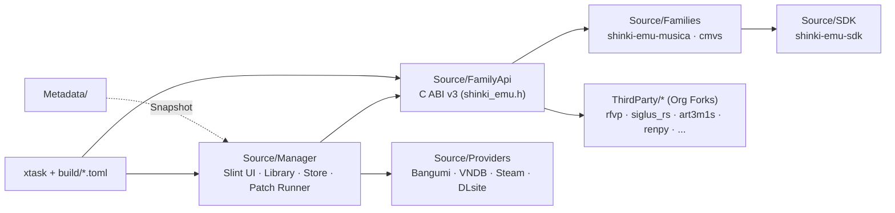

# Contributing to ShinkiEMU / 参与贡献

[English](#english) · [简体中文](#简体中文)

---

<a id="english"></a>

## English

Welcome! ShinkiEMU is built around a simple goal: making visual novels playable natively on modern devices while respecting upstream authors, licenses, and original game data. You do not need to write Rust or C++ to contribute.

### Ways to Contribute

| Level | Area | How to start |
|---|---|---|
| **1 · No code** | Compatibility reports &amp; community help | Test a title you own and submit a [Compatibility Report](https://github.com/Project-Shinkirou/ShinkiEMU/issues/new?template=compatibility.yml), or help answer questions in [GitHub Discussions](https://github.com/Project-Shinkirou/ShinkiEMU/discussions). |
| **2 · Docs &amp; i18n** | Documentation &amp; Manager translations | Improve `docs/{zh-cn,en,ja}/` or update `.po` translation catalogs in `Source/Manager/shinki-emu-manager-ui-slint/translations/`. |
| **3 · Patches** | Luau patch recipes | Author a sandboxed Luau patch bound to VNDB release fingerprints and submit via the [Patch Submission](https://github.com/Project-Shinkirou/ShinkiEMU/issues/new?template=patch.yml) form. |
| **4 · Engineering** | Manager, SDK, or native cores | Fix bugs, add features, adapt an existing open-source engine, or build a new core on `shinki-emu-sdk`. |

### Architecture at a Glance



### Quick Local Setup & Checks

All build, check, and test entry points run through `cargo xtask` from the repository root. Pick the component you touched so you do not mix unrelated native dependency graphs:

```sh
cargo xtask doctor --target x86_64-pc-windows-msvc
cargo xtask check --target x86_64-pc-windows-msvc --manager
cargo xtask check --target x86_64-pc-windows-msvc --core rfvp
cargo xtask test --manager
cargo xtask test --core rfvp
cargo xtask test
cargo xtask metadata validate
```

- `cargo xtask test` with no component flag runs `xtask` and build-helper tests (including icon generation and metadata intake parsing).
- Full build prerequisites and platform setups live in [Build from source](docs/en/build-and-release.md).

### Branching, PRs & External Cores

- **ShinkiEMU repository:** Branch from `main` and open a focused PR describing the behavior change, reproduction steps, and the exact commands you ran. Update callers, behavior regressions, and trilingual docs together.
- **External cores:** Submit adapter changes to the corresponding `Project-Shinkirou/<core>` fork through a PR targeting the adapter branch declared for that core in `build/cores.toml`. Then update that core's `[cores.source].rev` to the full merged commit hash (`cargo xtask deps` fetches it). Do not duplicate adapter code here or modify upstream's default branch. External cores are not Git submodules — `ThirdParty/cpal` is the only submodule.
- **Adding or integrating a core:** Follow our step-by-step skills in [shinkiemu-new-core](.agents/skills/shinkiemu-new-core/SKILL.md) and [shinkiemu-integrate-existing-core](.agents/skills/shinkiemu-integrate-existing-core/SKILL.md).

### Testing Standards

Keep behavior regressions that guard format/budget boundaries, corrupt inputs, save integrity, cancellation/backpressure, stale results, worker shutdown, CPU leases, and real consumers. Avoid brittle tests that only pin wording, constants, or mock call forwarding. Never delete failing behavior tests or disable real backends to make CI pass.

### Manager UI Translations

Simplified Chinese is the source language. Slint `@tr("…")` and Rust `tr!("…")` both use the Chinese sentence as the `msgid`. English and Japanese translations live in:

- `Source/Manager/shinki-emu-manager-ui-slint/translations/en/LC_MESSAGES/shinki-emu-manager-ui-slint.po`
- `Source/Manager/shinki-emu-manager-ui-slint/translations/ja/LC_MESSAGES/shinki-emu-manager-ui-slint.po`

Every new or changed string must be added to both `.po` files; missing or empty entries fail the build with `SHINKI_EMU_I18N_MISSING`. Keep one `msgid` per complete sentence (never concatenate fragments); use `{}` or `{0}`/`{1}` for interpolation; align terminology with `docs/en/` and `docs/ja/`; compare IDs or enums in code, never displayed text.

### AI / Agent-Assisted Contributions

We welcome thoughtful contributions built with AI coding assistants and provide structured project workflows under [`.agents/skills/`](.agents/skills/). Every PR — human-written or AI-assisted — is held to the same review bar:

1. You understand and can explain the changes you submit.
2. Every claimed behavior and command was genuinely built and verified (no fabricated test results or skipped backends).
3. Licensing, upstream attribution, and sensitive-data boundaries are strictly respected.

### Licensing & Sensitive Data Boundaries

Retain full author attribution, upstream provenance, and licenses; verify redistribution rights before adding dependencies or attachments. **Never commit** commercial game assets, scripts/text, saves, decryption keys, private profiles, decoded exports, or unredacted logs. Tests must use publicly licensed or synthetic fixtures only. Compatibility reports and Luau patches go through issue forms and maintainer review ([Metadata guide](docs/en/metadata.md)).

---

<a id="简体中文"></a>

## 简体中文

欢迎加入 ShinkiEMU！我们致力于让视觉小说在今天的设备上原生运行，同时尊重上游作者、开源许可与原版游戏数据。即使不写 Rust 或 C++，也有很多方式可以参与进来。

### 贡献阶梯

| 阶梯 | 方向 | 如何开始 |
|---|---|---|
| **1 · 零代码参与** | 兼容性测试与社区互助 | 测试你拥有的游戏并提交[兼容性报告](https://github.com/Project-Shinkirou/ShinkiEMU/issues/new?template=compatibility.yml)，或在 [GitHub Discussions](https://github.com/Project-Shinkirou/ShinkiEMU/discussions) 帮助解答新人问题。 |
| **2 · 文档与本地化** | 三语文档与界面翻译 | 完善 `docs/{zh-cn,en,ja}/` 文档，或补充 `Source/Manager/shinki-emu-manager-ui-slint/translations/` 下的 `.po` 翻译。 |
| **3 · 补丁生态** | Luau 补丁配方 | 编写绑定 VNDB 发行指纹的沙箱 Luau 补丁，通过[补丁投稿表单](https://github.com/Project-Shinkirou/ShinkiEMU/issues/new?template=patch.yml)提交审核。 |
| **4 · 代码与核心** | Manager、SDK 与原生核心 | 修复问题、完善功能、适配现有开源引擎，或基于 `shinki-emu-sdk` 开发新核心。 |

### 快速本地检查

仓库根目录下的所有构建、检查与测试入口统一由 `cargo xtask` 驱动。请按实际修改范围选择组件，避免混入无关核心的原生依赖图：

```sh
cargo xtask doctor --target x86_64-pc-windows-msvc
cargo xtask check --target x86_64-pc-windows-msvc --manager
cargo xtask check --target x86_64-pc-windows-msvc --core rfvp
cargo xtask test --manager
cargo xtask test --core rfvp
cargo xtask test
cargo xtask metadata validate
```

- 不带组件参数的 `cargo xtask test` 运行 `xtask` 与构建辅助库测试（涵盖图标生成与元数据表单解析）。
- 完整工具链与各平台依赖见[从源码构建](docs/zh-cn/build-and-release.md)。

### 分支、PR 与外部核心规范

- **主仓库改动**：从 `main` 建立功能分支并提交聚焦的普通 PR，说明行为变化、复现方式与实际运行的验证命令；源码、调用方、行为回归与三语文档同步更新。
- **外部核心改动**：按 `build/cores.toml` 中对应条目的声明，向 `Project-Shinkirou/<core>` fork 的适配分支提 PR。合并后更新 `[cores.source].rev` 的完整提交哈希（`cargo xtask deps` 按此拉取）。不在主仓库复制适配源码，也不修改上游默认分支。外部核心不是子模块，仓库唯一的子模块是 `ThirdParty/cpal`。
- **编写新核心或接入现有引擎**：按内置工作流 [shinkiemu-new-core](.agents/skills/shinkiemu-new-core/SKILL.md) 与 [shinkiemu-integrate-existing-core](.agents/skills/shinkiemu-integrate-existing-core/SKILL.md) 操作。

### 测试原则

保留覆盖格式/预算边界、损坏与超限输入、存档安全、取消与背压、迟到结果、工作线程退出、CPU 帧租约及真实消费者的行为回归测试。避免只锁死文案、常量、路径拼写或 mock 转发的脆弱测试；不要通过删除失败测试或关闭真实后端来让检查通过。

### Manager 界面翻译

Manager 以简体中文为源语言，Slint `@tr("…")` 与 Rust `tr!("…")` 均使用中文原文作为 `msgid`，英文与日文译文位于：

- `Source/Manager/shinki-emu-manager-ui-slint/translations/en/LC_MESSAGES/shinki-emu-manager-ui-slint.po`
- `Source/Manager/shinki-emu-manager-ui-slint/translations/ja/LC_MESSAGES/shinki-emu-manager-ui-slint.po`

新增或修改界面文案时需同步更新两个 `.po` 文件，缺失或空译文会触发 `SHINKI_EMU_I18N_MISSING` 构建报错。每条 `msgid` 保持完整句子（不拼接片段），变量占位用 `{}` 或 `{0}`/`{1}`，术语与 `docs/en/`、`docs/ja/` 对齐，逻辑判断始终比较 ID 或枚举而非显示文字。

### AI / Agent 辅助贡献规范

我们欢迎合理使用 AI 编程助手，并在仓库内维护了面向开发与维护的 [`.agents/skills/`](.agents/skills/) 指南。无论人工编写还是 AI 辅助，所有 PR 均适用相同的审查标准：

1. 提交者理解并能够说明所提交改动的设计意图与边界；
2. 所有声称的行为与命令均经过真实构建与测试验证，不伪造结果或绕过检查；
3. 严格遵守开源许可、上游署名与敏感数据红线。

### 来源、许可与敏感数据红线

完整保留作者署名、上游来源与许可证；引入新依赖或随包附件前核实再分发权利。**严禁提交**商业游戏素材、剧本正文、存档、解密密钥、私有配置、解码导出文件或含敏感信息的未脱敏日志，回归测试仅使用公开授权或自造夹具。兼容性报告与补丁通过 Issue 表单与维护者审查入库（见[元数据与补丁](docs/zh-cn/metadata.md)）。
