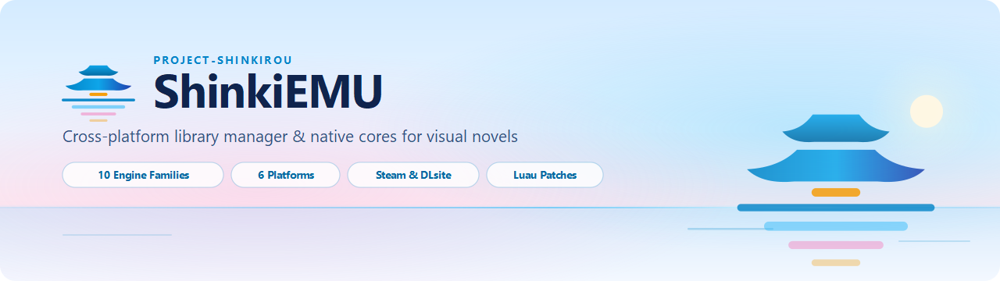
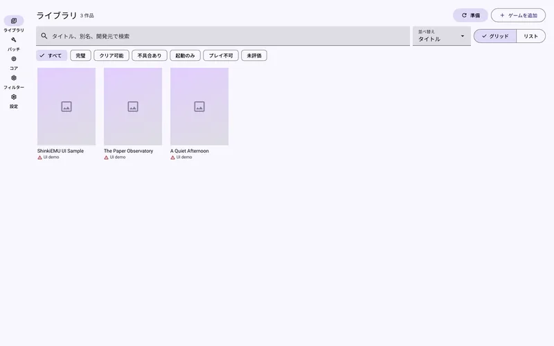
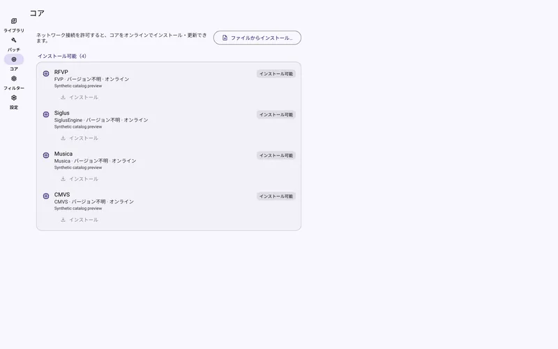

<picture>
  <source media="(prefers-color-scheme: dark)" srcset="docs/assets/readme-banner-dark.png">
  
</picture>

# ShinkiEMU

**名作ビジュアルノベルを、いまの PC とスマートフォンでネイティブに。**

[English](README.md) · [简体中文](README.zh-CN.md) · 日本語

[ポータル](https://project-shinkirou.github.io/ja/shinkiemu/) · [ダウンロード](https://project-shinkirou.github.io/ja/shinkiemu/#download) · [互換性](https://project-shinkirou.github.io/ja/shinkiemu/compatibility/) · [コア](https://project-shinkirou.github.io/ja/shinkiemu/cores/) · [パッチ](https://project-shinkirou.github.io/ja/shinkiemu/patches/) · [ドキュメント](docs/ja/index.md) · [Discussions](https://github.com/Project-Shinkirou/ShinkiEMU/discussions)

---

**ShinkiEMU** は、旧世代を含むさまざまなビジュアルノベルエンジンを現代の PC やスマートフォン上で動作させるための、統一ライブラリマネージャーとネイティブコア群です。ゲームの整理、コアの導入、Bangumi / VNDB メタデータ取得、公式ストアからの所有作品ダウンロード、安全なコミュニティパッチ適用までをひとつのネイティブアプリで完結できます。

> [!IMPORTANT]
> **無料・オープンソース · ベータ版**
> - **ShinkiEMU は完全無料のオープンソースソフトウェアです。**[公式ポータル](https://project-shinkirou.github.io/ja/shinkiemu/#download)または [GitHub Releases](https://github.com/Project-Shinkirou/ShinkiEMU/releases) からのみ入手してください。有料で購入された場合は返金を求め、転売者を通報してください。
> - **最新リリース：**[`Manager 0.1.0-beta.8`](https://github.com/Project-Shinkirou/ShinkiEMU/releases/tag/manager-v0.1.0-beta.8)。エンジンの自動認識は完走可能を保証するものではありません。作品・環境ごとの実測結果は[互換性一覧](https://project-shinkirou.github.io/ja/shinkiemu/compatibility/)をご確認ください。

## 主な特徴

- **モジュール式ネイティブコア** — 10 エンジン系統に対応する 11 種のネイティブコアを提供。VM、描画、音声、メニュー、セーブ仕様を各エンジン本来の形で維持します。デスクトップ版はアプリ内から独立導入・更新でき、モバイル版はコアを同梱しています。
- **統一ライブラリとメタデータ** — ローカルの作品フォルダを自動検出し、Bangumi / VNDB から作品情報を取得。日本語・英語・簡体字中国語の 3 言語 UI とライト／ダークテーマに対応しています。
- **ストア連携ダウンロード** — Manager 内で **Steam** や **DLsite** にサインインし、所有済みの PC 版作品を直接ライブラリへダウンロード可能。Steam は差分更新と整合性検証に対応し、認証情報は OS の安全な資格情報ストアのみに保存されます。*（DMM GAMES/FANZA は現在サインインのみ対応）*
- **サンドボックス化 Luau パッチ** — [パッチライブラリ](https://project-shinkirou.github.io/ja/shinkiemu/patches/)のレビュー済みレシピやローカルの `.luau`/ZIP を安全に適用。標準では別フォルダへ出力し元データを保護し、上書きモードでもハッシュ検証付きバックアップからワンクリックで復元できます。

## スクリーンショット

<table>
  <tr>
    <td width="50%">
      <picture>
        <source media="(prefers-color-scheme: dark)" srcset="docs/assets/shots/dark/library-ja.webp">
        
      </picture>
    </td>
    <td width="50%">
      <picture>
        <source media="(prefers-color-scheme: dark)" srcset="docs/assets/shots/dark/cores-ja.webp">
        
      </picture>
    </td>
  </tr>
  <tr>
    <td align="center">ゲームライブラリと起動</td>
    <td align="center">コア管理カタログ</td>
  </tr>
</table>

パッチ画面や設定画面を含むその他のスクリーンショットは [ShinkiEMU 公式ポータル](https://project-shinkirou.github.io/ja/shinkiemu/)でご覧いただけます。

## 3 ステップで始める

1. **ダウンロード** — [ポータル](https://project-shinkirou.github.io/ja/shinkiemu/#download)または [GitHub Releases](https://github.com/Project-Shinkirou/ShinkiEMU/releases) からお使いのプラットフォーム向け Manager を入手します。
2. **ゲームを追加** — 展開して `shinki-emu-manager`（Windows は `.exe`、Linux の必要ランタイムは[トラブルシューティング](docs/ja/troubleshooting.md#linux-デスクトップランタイム)参照）を起動し、**設定**からゲームフォルダを登録するか、**ゲームを追加 → ストアダウンロード**で所有作品を取得します。
3. **コアを入れて起動** — デスクトップ版ではアプリ内の**コア**画面から必要なコアを導入し、ライブラリから作品を選んで起動します。

詳しくは[クイックスタート](docs/ja/quick-start.md)と[ユーザーガイド](docs/ja/user-guide.md)をご覧ください。

## 対応プラットフォームとコア

[`Manager 0.1.0-beta.8`](https://github.com/Project-Shinkirou/ShinkiEMU/releases/tag/manager-v0.1.0-beta.8) 時点の公開コア一覧（[`build/cores.toml`](build/cores.toml) 定義）：

| エンジン系統 | コア | Windows x64 | Linux x64 | macOS x64/arm64 | Android | iOS | OpenHarmony |
|---|---|---|---|---|---|---|---|
| FVP | [`rfvp`](docs/ja/cores/rfvp.md) | ✓ | ✓ | ✓ | 同梱 | 同梱 | — |
| SiglusEngine | [`siglus_rs`](docs/ja/cores/siglus-rs.md) | ✓ | ✓ | ✓ | 同梱 | 同梱 | — |
| Artemis | [`art3m1s-core`](docs/ja/cores/art3m1s-core.md) | ✓ | ✓ | ✓ | 同梱 | — | — |
| Musica | [`shinki.emu.musica`](docs/ja/cores/shinki-emu-musica.md) | ✓ | ✓ | ✓ | 同梱 | 同梱 | 同梱 |
| Musica | [`ReMinori`](docs/ja/cores/reminori.md) | ✓ | ✓ | ✓ | — | 同梱 | — |
| CMVS | [`shinki.emu.cmvs`](docs/ja/cores/shinki-emu-cmvs.md) | ✓ | ✓ | ✓ | 同梱 | — | — |
| KiriKiri | [`kirikiroid2-web`](docs/ja/cores/kirikiroid2-web.md) | ✓ | ✓ | ✓ | 同梱 | — | — |
| MAGES. | [`impacto`](docs/ja/cores/impacto.md) | ✓ | ✓ | ✓ | 同梱 | — | — |
| Ren'Py | [`renpy`](docs/ja/cores/renpy.md) | ✓ | ✓ | ✓ | 同梱 | — | — |
| SoftPAL | [`sena-rs`](docs/ja/cores/sena-rs.md) | ✓ | ✓ | ✓ | — | 同梱 | — |
| BGI / Ethornell | [`ethornell-rs`](docs/ja/cores/ethornell-rs.md) | ✓ | ✓ | ✓ | — | 同梱 | — |

- **✓** はデスクトップ版コアカタログ公開済み、**同梱** は `Manager 0.1.0-beta.8` への静的組み込み（Android 汎用 APK に 8 コア、iOS テストビルドに 6 コア、OpenHarmony 実験用 HAP に Musica）。
- **プラットフォーム補足：** Android はリリース署名済み汎用 APK（`arm64-v8a` + `x86_64`）、iOS は ad-hoc 署名のテストビルド、OpenHarmony は実験的な SDK テスト署名 HAP（実機起動および市販端末への導入は未検証）です。

<strong>コア別の対応形式とセーブ仕様を見る</strong>

| コア | エンジン系統 | 主な対応形式と範囲 |
|---|---|---|
| `rfvp` | FVP | HCB バイトコード |
| `siglus_rs` | SiglusEngine | `Scene.pck` シーンパッケージ |
| `sena-rs` | SoftPAL | `SCRIPT.SRC` バイトコードと `.DAT` テーブル（原版・Steam 版 Koikake） |
| `ethornell-rs` | BGI / Ethornell | BCS シナリオ、BP システムプログラム、DSC 圧縮アーカイブ |
| `ReMinori` | Musica | PAZ アーカイブ（*eden** 向け実装） |
| `shinki.emu.musica` | Musica | PAZ アーカイブと SC スクリプト、`<game>/.shinki/musica/` の原版互換 `.sav` |
| `art3m1s-core` | Artemis | `system.ini`、PFS（PF6/PF8）アーカイブ、`.pfs.NNN` パッチ巻 |
| `renpy` | Ren'Py | 公式 Ren'Py 8.5.3 ランタイム |
| `shinki.emu.cmvs` | CMVS | CPZ5 アーカイブと PS2A スクリプト |
| `kirikiroid2-web` | KiriKiri | XP3 アーカイブと KAG/TJS スクリプト |
| `impacto` | MAGES. | MAGES. SC3 スクリプトと作品別設定 |

外部コアはアップストリームのセーブ場所・形式を維持します。ShinkiEMU 自身がゲームフォルダ内に生成するファイルはすべて `<game>/.shinki/` 以下に格納されます。セーブのバックアップや移行を行う前にゲームを終了してください。

## コミュニティと参加方法

コードを書かなくても ShinkiEMU に貢献できる方法が数多くあります：

- **互換性レポートの投稿** — 動作確認した作品を[互換性レポートフォーム](https://github.com/Project-Shinkirou/ShinkiEMU/issues/new?template=compatibility.yml)から共有してください。
- **ディスカッションへの参加** — 質問、Tips 共有、機能アイデアは [GitHub Discussions](https://github.com/Project-Shinkirou/ShinkiEMU/discussions) へどうぞ。
- **翻訳・ドキュメント改善** — 日本語・英語・簡体字中国語のドキュメントや UI 翻訳（`.po`）の改善を歓迎します。
- **Luau パッチの投稿** — 翻訳や互換パッチレシピを[パッチ投稿フォーム](https://github.com/Project-Shinkirou/ShinkiEMU/issues/new?template=patch.yml)から提出できます。
- **開発・コア移植** — [CONTRIBUTING.md](CONTRIBUTING.md)、[コア ABI と SDK](docs/ja/core-abi.md)、および内蔵エージェントガイド [`.agents/skills/`](.agents/skills/) をご覧ください。

> [!NOTE]
> **プロジェクトの支援について：** Project-Shinkirou では**金銭的な寄付を受け付けていません**。GitHub の Star、正確な互換性レポートの提供、Discussions での助け合い、パッチや翻訳・PR の投稿が最大の支援になります。

### 問題の報告

- まず [FAQ](https://project-shinkirou.github.io/ja/shinkiemu/faq/) と[トラブルシューティング](docs/ja/troubleshooting.md)をご確認ください。
- [バグ報告](https://github.com/Project-Shinkirou/ShinkiEMU/issues/new?template=bug.yml) · [互換性レポート](https://github.com/Project-Shinkirou/ShinkiEMU/issues/new?template=compatibility.yml) · [Luau パッチ投稿](https://github.com/Project-Shinkirou/ShinkiEMU/issues/new?template=patch.yml) · [機能・エンジン要望](https://github.com/Project-Shinkirou/ShinkiEMU/issues/new?template=feature_request.yml)
- **セキュリティ脆弱性：** 公開 Issue ではなく [GitHub Security Advisories](https://github.com/Project-Shinkirou/ShinkiEMU/security/advisories/new) から非公開でご報告ください（[SECURITY.md](SECURITY.md)）。

## ドキュメント

| トピック | 日本語 | English | 简体中文 |
|---|---|---|---|
| 概要 | [概要](docs/ja/index.md) | [index](docs/en/index.md) | [概览](docs/zh-cn/index.md) |
| クイックスタート | [クイックスタート](docs/ja/quick-start.md) | [quick-start](docs/en/quick-start.md) | [快速上手](docs/zh-cn/quick-start.md) |
| ユーザーガイド | [ユーザーガイド](docs/ja/user-guide.md) | [user-guide](docs/en/user-guide.md) | [用户指南](docs/zh-cn/user-guide.md) |
| トラブルシューティング | [トラブルシューティング](docs/ja/troubleshooting.md) | [troubleshooting](docs/en/troubleshooting.md) | [故障排查](docs/zh-cn/troubleshooting.md) |
| コントリビュート | [コントリビュート](docs/ja/contributing.md) | [contributing](docs/en/contributing.md) | [贡献指南](docs/zh-cn/contributing.md) |
| メタデータとパッチ | [メタデータとパッチ](docs/ja/metadata.md) | [metadata](docs/en/metadata.md) | [元数据与补丁](docs/zh-cn/metadata.md) |
| ソースからのビルド | [ソースからのビルド](docs/ja/build-and-release.md) | [build-and-release](docs/en/build-and-release.md) | [从源码构建](docs/zh-cn/build-and-release.md) |
| コア ABI と SDK | [コア ABI と SDK](docs/ja/core-abi.md) | [core-abi](docs/en/core-abi.md) | [核心 ABI 与 SDK](docs/zh-cn/core-abi.md) |
| ヘッドレス実行 | [ヘッドレス実行](docs/ja/headless.md) | [headless](docs/en/headless.md) | [无窗口运行](docs/zh-cn/headless.md) |
| リリース手順書 | [リリース手順書](docs/ja/release-runbook.md) | [release-runbook](docs/en/release-runbook.md) | [发布维护手册](docs/zh-cn/release-runbook.md) |

## 謝辞

9 つの外部コアは、以下のオープンソースエンジン実装上の薄いアダプターです。作者およびコントリビューターの皆様に感謝いたします。`shinki.emu.musica` と `shinki.emu.cmvs` は ShinkiEMU 独自実装です。

| コア | エンジン系統 | アップストリーム | 作者・組織 | ライセンス |
|---|---|---|---|---|
| `rfvp` | FVP | [xmoezzz/rfvp](https://github.com/xmoezzz/rfvp) | xmoe（[@xmoezzz](https://github.com/xmoezzz)） | [MPL-2.0](https://github.com/xmoezzz/rfvp/blob/99435f22e94eaec27c0c1b9f22cc2a6b1910d7d1/LICENSE) |
| `siglus_rs` | SiglusEngine | [xmoezzz/siglus_rs](https://github.com/xmoezzz/siglus_rs) | xmoe（[@xmoezzz](https://github.com/xmoezzz)） | [MPL-2.0](https://github.com/xmoezzz/siglus_rs/blob/5f358ef1360b0439e92aed2b749e8f25d8721954/LICENSE-MPL-2.0) |
| `sena-rs` | SoftPAL | [xmoezzz/sena-rs](https://github.com/xmoezzz/sena-rs) | xmoe（[@xmoezzz](https://github.com/xmoezzz)） | [MPL-2.0](https://github.com/xmoezzz/sena-rs/blob/7f633dbb89408297827d6c1857eb8e97dc363dff/LICENSE-MPL-2.0) |
| `ethornell-rs` | BGI / Ethornell | [xmoezzz/ethornell-rs](https://github.com/xmoezzz/ethornell-rs) | xmoe（[@xmoezzz](https://github.com/xmoezzz)） | MPL-2.0（[manifest](https://github.com/xmoezzz/ethornell-rs/blob/b5de417e4cff681bd2afb929e22e903d64602456/Cargo.toml)） |
| `ReMinori` | Musica | [luoyily/ReMinori](https://github.com/luoyily/ReMinori) | [@luoyily](https://github.com/luoyily) | [AGPL-3.0](https://github.com/luoyily/ReMinori/blob/79b00990324404bfbd496e7fa76c690cf040f744/LICENSE) |
| `art3m1s-core` | Artemis | [Alphaly2K/art3m1s-core](https://github.com/Alphaly2K/art3m1s-core) | Alphaly（[@Alphaly2K](https://github.com/Alphaly2K)） | [MPL-2.0](https://github.com/Alphaly2K/art3m1s-core/blob/ad90a62cb192b119b7cf8589aa7f87a94bd747c8/LICENSE) / `pf8` は [MIT](https://github.com/Alphaly2K/art3m1s-core/blob/ad90a62cb192b119b7cf8589aa7f87a94bd747c8/crates/pf8/LICENSE) |
| `renpy` | Ren'Py | [renpy/renpy](https://github.com/renpy/renpy) | The Ren'Py Visual Novel Engine Project（[@renpy](https://github.com/renpy)）、Tom Rothamel | [MIT（一部 LGPL）](https://github.com/renpy/renpy/blob/39895c1e017f0b36ffea2447d97eccd69d76ee1c/sphinx/source/license.rst) |
| `kirikiroid2-web` | KiriKiri | [fenghengzhi/kirikiroid2-web](https://github.com/fenghengzhi/kirikiroid2-web)（[krkr2](https://github.com/2468785842/krkr2) フォーク） | [@fenghengzhi](https://github.com/fenghengzhi)、KiriKiri2 copyright W.Dee &amp; contributors | [KiriKiri2 および同梱ライセンス](https://github.com/fenghengzhi/kirikiroid2-web/blob/2028cbccaa91498bd36f270d349ae711d0e8fed3/LICENSE) |
| `impacto` | MAGES. | [CommitteeOfZero/impacto](https://github.com/CommitteeOfZero/impacto) | Committee of Zero（[@CommitteeOfZero](https://github.com/CommitteeOfZero)） | [ISC](https://github.com/CommitteeOfZero/impacto/blob/3706ddd89d4ad4aed0e32e127355c4251f22e574/LICENSE) |

ライセンスリンクは [`build/cores.toml`](build/cores.toml) に固定されたアップストリーム版を指しています。詳細は [THIRD_PARTY_NOTICES.md](THIRD_PARTY_NOTICES.md) をご覧ください。

## ライセンスとブランド

プロジェクト独自コードは [MIT](LICENSE-MIT) または [Apache-2.0](LICENSE-APACHE) のデュアルライセンスです。外部コア・依存ライブラリ・素材には元のライセンスが適用され（[THIRD_PARTY_NOTICES.md](THIRD_PARTY_NOTICES.md) · [ORIGINS.md](ORIGINS.md)）、各コアリリースには対応ソースアーカイブを同梱しています。ブランドアセットとガイドラインは [Assets/Branding/BRANDING.md](Assets/Branding/BRANDING.md) をご覧ください。

共有ランタイムライブラリは姉妹プロジェクトの [RoukakuEngine](https://github.com/Project-Shinkirou/RoukakuEngine) から提供されています。
