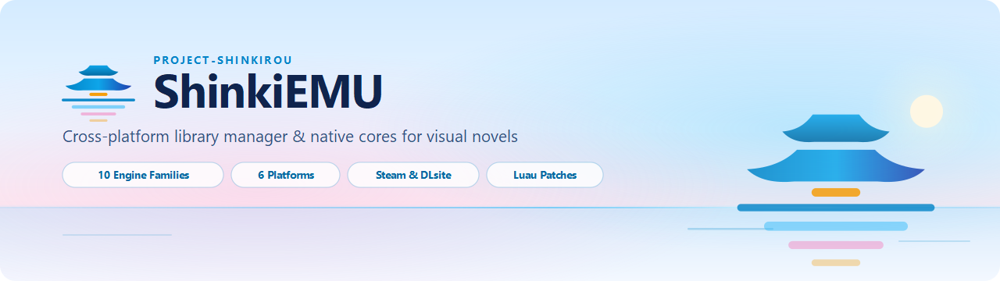
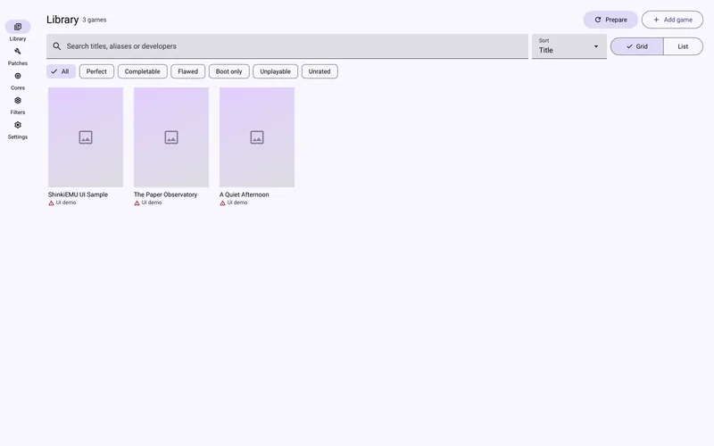
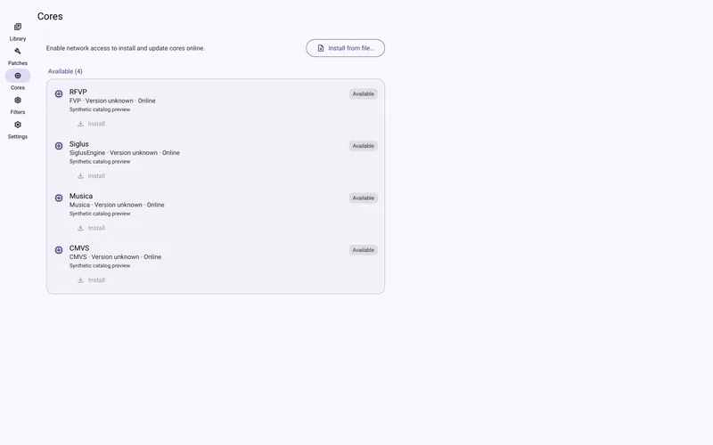

<picture>
  <source media="(prefers-color-scheme: dark)" srcset="docs/assets/readme-banner-dark.png">
  
</picture>

# ShinkiEMU

**One native home for your visual novel library — across desktop and mobile.**

English · [简体中文](README.zh-CN.md) · [日本語](README.ja.md)

[Portal](https://project-shinkirou.github.io/en/shinkiemu/) · [Download](https://project-shinkirou.github.io/en/shinkiemu/#download) · [Compatibility](https://project-shinkirou.github.io/en/shinkiemu/compatibility/) · [Cores](https://project-shinkirou.github.io/en/shinkiemu/cores/) · [Patches](https://project-shinkirou.github.io/en/shinkiemu/patches/) · [Docs](docs/en/index.md) · [Discussions](https://github.com/Project-Shinkirou/ShinkiEMU/discussions)

---

**ShinkiEMU** brings classic and modern visual novel engines to today's computers and phones through a unified library manager and modular native cores. Instead of wrestling with locale emulators, virtual machines, or scattered engine forks, manage your games, cores, metadata, store downloads, and community patches in one clean native app.

> [!IMPORTANT]
> **Free & Open Source · Beta Software**
> - **ShinkiEMU is 100% free and open source.** Download it only from our [official portal](https://project-shinkirou.github.io/en/shinkiemu/#download) or [GitHub Releases](https://github.com/Project-Shinkirou/ShinkiEMU/releases). If you paid someone for this software, request a refund and report the seller.
> - **Current release:** [`Manager 0.1.0-beta.8`](https://github.com/Project-Shinkirou/ShinkiEMU/releases/tag/manager-v0.1.0-beta.8). Engine detection alone does not guarantee playability — check the [Compatibility Catalog](https://project-shinkirou.github.io/en/shinkiemu/compatibility/) for per-game, per-platform reports.

## Highlights

- **Native Engine Cores** — 11 native cores covering 10 engine families. Each core preserves the engine's own VM, rendering, audio, menus, and save behavior. Desktop Managers install and update cores independently as plugins; mobile Managers bundle them directly.
- **Unified Library & Metadata** — Organize local game folders with automatic core detection, Bangumi & VNDB metadata lookup, and a trilingual UI (Simplified Chinese, English, Japanese) with light and dark themes.
- **Built-in Store Downloads** — Sign in directly to **Steam** or **DLsite** inside the Manager to download PC titles you own, with incremental updates and file verification for Steam. Credentials stay strictly in your OS secret store. *(DMM GAMES/FANZA currently supports sign-in only.)*
- **Sandboxed Luau Patches** — Apply reviewed localization or compatibility patches from the [Patch Library](https://project-shinkirou.github.io/en/shinkiemu/patches/) or load local `.luau`/ZIP scripts. By default, patches write to a new directory leaving your original game untouched; in-place mode keeps automatic hash-verified backups for one-click restore.

## Preview

<table>
  <tr>
    <td width="50%">
      <picture>
        <source media="(prefers-color-scheme: dark)" srcset="docs/assets/shots/dark/library-en.webp">
        
      </picture>
    </td>
    <td width="50%">
      <picture>
        <source media="(prefers-color-scheme: dark)" srcset="docs/assets/shots/dark/cores-en.webp">
        
      </picture>
    </td>
  </tr>
  <tr>
    <td align="center">Game Library &amp; Launch</td>
    <td align="center">Modular Core Catalog</td>
  </tr>
</table>

See more screenshots (Patches, Settings, and light/dark themes) on the [ShinkiEMU Portal](https://project-shinkirou.github.io/en/shinkiemu/).

## Quick Start

1. **Download** the Manager for your platform from the [Portal](https://project-shinkirou.github.io/en/shinkiemu/#download) or [GitHub Releases](https://github.com/Project-Shinkirou/ShinkiEMU/releases).
2. **Launch & add games** — Extract and run `shinki-emu-manager` (`.exe` on Windows; on Linux, install the desktop runtime libraries listed in [Troubleshooting](docs/en/troubleshooting.md#linux-runtime-libraries)). Add your game directories in **Settings** or download owned titles from **Add Game → Store Download**.
3. **Install cores & play** — On desktop, install the cores your games need from the in-app **Cores** page, then select a game and click **Launch**.

Read the [3-Minute Quick Start](docs/en/quick-start.md) or full [User Guide](docs/en/user-guide.md) for details on saves, store logins, and patches.

## Supported Platforms & Cores

Published cores as of [`Manager 0.1.0-beta.8`](https://github.com/Project-Shinkirou/ShinkiEMU/releases/tag/manager-v0.1.0-beta.8) (defined in [`build/cores.toml`](build/cores.toml)):

| Engine Family | Core | Windows x64 | Linux x64 | macOS x64/arm64 | Android | iOS | OpenHarmony |
|---|---|---|---|---|---|---|---|
| FVP | [`rfvp`](docs/en/cores/rfvp.md) | ✓ | ✓ | ✓ | Built in | Built in | — |
| SiglusEngine | [`siglus_rs`](docs/en/cores/siglus-rs.md) | ✓ | ✓ | ✓ | Built in | Built in | — |
| Artemis | [`art3m1s-core`](docs/en/cores/art3m1s-core.md) | ✓ | ✓ | ✓ | Built in | — | — |
| Musica | [`shinki.emu.musica`](docs/en/cores/shinki-emu-musica.md) | ✓ | ✓ | ✓ | Built in | Built in | Built in |
| Musica | [`ReMinori`](docs/en/cores/reminori.md) | ✓ | ✓ | ✓ | — | Built in | — |
| CMVS | [`shinki.emu.cmvs`](docs/en/cores/shinki-emu-cmvs.md) | ✓ | ✓ | ✓ | Built in | — | — |
| KiriKiri | [`kirikiroid2-web`](docs/en/cores/kirikiroid2-web.md) | ✓ | ✓ | ✓ | Built in | — | — |
| MAGES. | [`impacto`](docs/en/cores/impacto.md) | ✓ | ✓ | ✓ | Built in | — | — |
| Ren'Py | [`renpy`](docs/en/cores/renpy.md) | ✓ | ✓ | ✓ | Built in | — | — |
| SoftPAL | [`sena-rs`](docs/en/cores/sena-rs.md) | ✓ | ✓ | ✓ | — | Built in | — |
| BGI / Ethornell | [`ethornell-rs`](docs/en/cores/ethornell-rs.md) | ✓ | ✓ | ✓ | — | Built in | — |

- **✓** = published in the desktop core catalog; **Built in** = statically linked into `Manager 0.1.0-beta.8` (8 cores on Android universal APK, 6 on iOS test builds, Musica on experimental OpenHarmony HAP).
- **Platform notes:** Android ships as one release-signed universal APK (`arm64-v8a` + `x86_64`); iOS ships ad-hoc device/simulator test builds; OpenHarmony ships an experimental SDK test-signed HAP (device launch and retail installation not yet verified).

<strong>Technical format &amp; save details by core</strong>

| Core | Engine Family | Primary Formats &amp; Scope |
|---|---|---|
| `rfvp` | FVP | HCB bytecode |
| `siglus_rs` | SiglusEngine | `Scene.pck` scene packages |
| `sena-rs` | SoftPAL | `SCRIPT.SRC` bytecode and `.DAT` tables (native &amp; Steam Koikake) |
| `ethornell-rs` | BGI / Ethornell | BCS scenarios, BP system programs, DSC archives |
| `ReMinori` | Musica | PAZ archives (built around *eden**) |
| `shinki.emu.musica` | Musica | PAZ archives &amp; SC scripts; original-format eden/Perseus `.sav` saves under `<game>/.shinki/musica/` |
| `art3m1s-core` | Artemis | `system.ini`, PFS (PF6/PF8) archives, `.pfs.NNN` patches |
| `renpy` | Ren'Py | Official Ren'Py 8.5.3 runtime |
| `shinki.emu.cmvs` | CMVS | CPZ5 archives &amp; PS2A scripts |
| `kirikiroid2-web` | KiriKiri | XP3 archives &amp; KAG/TJS scripts |
| `impacto` | MAGES. | MAGES. SC3 scripts with per-game configuration |

External cores follow upstream save locations and formats. Files created by ShinkiEMU itself always stay inside `<game>/.shinki/`. Close any running game before backing up or exchanging saves.

## Community & How to Contribute

ShinkiEMU grows with its community — and you do **not** need to write Rust or C++ to make a real impact:

- **Report game compatibility** — Tested a title? Submit a [Compatibility Report](https://github.com/Project-Shinkirou/ShinkiEMU/issues/new?template=compatibility.yml) to help other players know what works on each platform.
- **Join the conversation** — Ask questions, share tips, or propose ideas in [GitHub Discussions](https://github.com/Project-Shinkirou/ShinkiEMU/discussions).
- **Translate & improve docs** — Help polish the Simplified Chinese, English, and Japanese UI (`.po`) or documentation.
- **Create Luau patches** — Write and submit reviewed localization/fix recipes via the [Patch Submission](https://github.com/Project-Shinkirou/ShinkiEMU/issues/new?template=patch.yml) form.
- **Develop Manager or native cores** — Check [CONTRIBUTING.md](CONTRIBUTING.md), our [Core ABI & SDK guide](docs/en/core-abi.md), and the built-in agent workflows in [`.agents/skills/`](.agents/skills/).

> [!NOTE]
> **Supporting the project:** Project-Shinkirou does **not** accept financial donations. The best ways to support ShinkiEMU are starring the repository, submitting accurate compatibility reports, helping newcomers in Discussions, and contributing patches, translations, or PRs.

### Reporting Issues

- Check the [FAQ](https://project-shinkirou.github.io/en/shinkiemu/faq/) and [Troubleshooting](docs/en/troubleshooting.md) first.
- [Bug Report](https://github.com/Project-Shinkirou/ShinkiEMU/issues/new?template=bug.yml) · [Compatibility Report](https://github.com/Project-Shinkirou/ShinkiEMU/issues/new?template=compatibility.yml) · [Luau Patch Submission](https://github.com/Project-Shinkirou/ShinkiEMU/issues/new?template=patch.yml) · [Feature / Engine Request](https://github.com/Project-Shinkirou/ShinkiEMU/issues/new?template=feature_request.yml)
- **Security vulnerabilities:** Please report privately via [GitHub Security Advisories](https://github.com/Project-Shinkirou/ShinkiEMU/security/advisories/new) (see [SECURITY.md](SECURITY.md)).

## Documentation

| Topic | English | 简体中文 | 日本語 |
|---|---|---|---|
| Overview | [index](docs/en/index.md) | [概览](docs/zh-cn/index.md) | [概要](docs/ja/index.md) |
| Quick start | [quick-start](docs/en/quick-start.md) | [快速上手](docs/zh-cn/quick-start.md) | [クイックスタート](docs/ja/quick-start.md) |
| User guide | [user-guide](docs/en/user-guide.md) | [用户指南](docs/zh-cn/user-guide.md) | [ユーザーガイド](docs/ja/user-guide.md) |
| Troubleshooting | [troubleshooting](docs/en/troubleshooting.md) | [故障排查](docs/zh-cn/troubleshooting.md) | [トラブルシューティング](docs/ja/troubleshooting.md) |
| Contributing | [contributing](docs/en/contributing.md) | [贡献指南](docs/zh-cn/contributing.md) | [コントリビュート](docs/ja/contributing.md) |
| Metadata & patches | [metadata](docs/en/metadata.md) | [元数据与补丁](docs/zh-cn/metadata.md) | [メタデータとパッチ](docs/ja/metadata.md) |
| Build from source | [build-and-release](docs/en/build-and-release.md) | [从源码构建](docs/zh-cn/build-and-release.md) | [ソースからのビルド](docs/ja/build-and-release.md) |
| Core ABI & SDK | [core-abi](docs/en/core-abi.md) | [核心 ABI 与 SDK](docs/zh-cn/core-abi.md) | [コア ABI と SDK](docs/ja/core-abi.md) |
| Headless runner | [headless](docs/en/headless.md) | [无窗口运行](docs/zh-cn/headless.md) | [ヘッドレス実行](docs/ja/headless.md) |
| Release runbook | [release-runbook](docs/en/release-runbook.md) | [发布维护手册](docs/zh-cn/release-runbook.md) | [リリース手順書](docs/ja/release-runbook.md) |

## Acknowledgements

Nine external cores are thin adapters over outstanding open-source engine implementations. Thank you to their authors and contributors. `shinki.emu.musica` and `shinki.emu.cmvs` are ShinkiEMU's own implementations.

| Core | Engine family | Upstream project | Author or organization | License |
|---|---|---|---|---|
| `rfvp` | FVP | [xmoezzz/rfvp](https://github.com/xmoezzz/rfvp) | xmoe ([@xmoezzz](https://github.com/xmoezzz)) | [MPL-2.0](https://github.com/xmoezzz/rfvp/blob/99435f22e94eaec27c0c1b9f22cc2a6b1910d7d1/LICENSE) |
| `siglus_rs` | SiglusEngine | [xmoezzz/siglus_rs](https://github.com/xmoezzz/siglus_rs) | xmoe ([@xmoezzz](https://github.com/xmoezzz)) | [MPL-2.0](https://github.com/xmoezzz/siglus_rs/blob/5f358ef1360b0439e92aed2b749e8f25d8721954/LICENSE-MPL-2.0) |
| `sena-rs` | SoftPAL | [xmoezzz/sena-rs](https://github.com/xmoezzz/sena-rs) | xmoe ([@xmoezzz](https://github.com/xmoezzz)) | [MPL-2.0](https://github.com/xmoezzz/sena-rs/blob/7f633dbb89408297827d6c1857eb8e97dc363dff/LICENSE-MPL-2.0) |
| `ethornell-rs` | BGI / Ethornell | [xmoezzz/ethornell-rs](https://github.com/xmoezzz/ethornell-rs) | xmoe ([@xmoezzz](https://github.com/xmoezzz)) | MPL-2.0 ([manifest](https://github.com/xmoezzz/ethornell-rs/blob/b5de417e4cff681bd2afb929e22e903d64602456/Cargo.toml)) |
| `ReMinori` | Musica | [luoyily/ReMinori](https://github.com/luoyily/ReMinori) | [@luoyily](https://github.com/luoyily) | [AGPL-3.0](https://github.com/luoyily/ReMinori/blob/79b00990324404bfbd496e7fa76c690cf040f744/LICENSE) |
| `art3m1s-core` | Artemis | [Alphaly2K/art3m1s-core](https://github.com/Alphaly2K/art3m1s-core) | Alphaly ([@Alphaly2K](https://github.com/Alphaly2K)) | [MPL-2.0](https://github.com/Alphaly2K/art3m1s-core/blob/ad90a62cb192b119b7cf8589aa7f87a94bd747c8/LICENSE); `pf8` is [MIT](https://github.com/Alphaly2K/art3m1s-core/blob/ad90a62cb192b119b7cf8589aa7f87a94bd747c8/crates/pf8/LICENSE) |
| `renpy` | Ren'Py | [renpy/renpy](https://github.com/renpy/renpy) | The Ren'Py Visual Novel Engine Project ([@renpy](https://github.com/renpy)); Tom Rothamel | [MIT, with LGPL portions](https://github.com/renpy/renpy/blob/39895c1e017f0b36ffea2447d97eccd69d76ee1c/sphinx/source/license.rst) |
| `kirikiroid2-web` | KiriKiri | [fenghengzhi/kirikiroid2-web](https://github.com/fenghengzhi/kirikiroid2-web) (fork of [krkr2](https://github.com/2468785842/krkr2)) | [@fenghengzhi](https://github.com/fenghengzhi); KiriKiri2 copyright W.Dee &amp; contributors | [KiriKiri2 &amp; component licenses](https://github.com/fenghengzhi/kirikiroid2-web/blob/2028cbccaa91498bd36f270d349ae711d0e8fed3/LICENSE) |
| `impacto` | MAGES. | [CommitteeOfZero/impacto](https://github.com/CommitteeOfZero/impacto) | Committee of Zero ([@CommitteeOfZero](https://github.com/CommitteeOfZero)) | [ISC](https://github.com/CommitteeOfZero/impacto/blob/3706ddd89d4ad4aed0e32e127355c4251f22e574/LICENSE) |

License links point to the upstream revisions pinned in [`build/cores.toml`](build/cores.toml). Full third-party notices live in [THIRD_PARTY_NOTICES.md](THIRD_PARTY_NOTICES.md).

## License & Brand

Project-owned code is dual-licensed under [MIT](LICENSE-MIT) or [Apache-2.0](LICENSE-APACHE), at your option. External cores, dependencies, and assets keep their respective licenses ([THIRD_PARTY_NOTICES.md](THIRD_PARTY_NOTICES.md) · [ORIGINS.md](ORIGINS.md)), and every core release includes a corresponding-source archive. Brand assets and usage guidelines live in [Assets/Branding/BRANDING.md](Assets/Branding/BRANDING.md).

Shared runtime libraries come from our sister project, [RoukakuEngine](https://github.com/Project-Shinkirou/RoukakuEngine).
