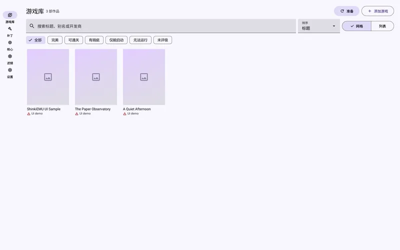
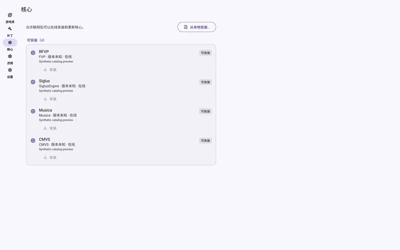

<picture>
  <source media="(prefers-color-scheme: dark)" srcset="docs/assets/readme-banner-dark.png">
  
</picture>

# ShinkiEMU

**让每一部视觉小说，在今天的电脑与手机上原生重现。**

[English](README.md) · 简体中文 · [日本語](README.ja.md)

[官方门户](https://project-shinkirou.github.io/zh-cn/shinkiemu/) · [下载](https://project-shinkirou.github.io/zh-cn/shinkiemu/#download) · [兼容性](https://project-shinkirou.github.io/zh-cn/shinkiemu/compatibility/) · [核心目录](https://project-shinkirou.github.io/zh-cn/shinkiemu/cores/) · [补丁库](https://project-shinkirou.github.io/zh-cn/shinkiemu/patches/) · [文档](docs/zh-cn/index.md) · [社区讨论](https://github.com/Project-Shinkirou/ShinkiEMU/discussions)

---

**ShinkiEMU** 将经典的旧视觉小说引擎带到现代桌面与移动设备上。通过统一的 **Manager** 应用与模块化**原生引擎核心**，你可以在一个清爽的原生界面中管理游戏库、按需安装引擎核心、同步 Bangumi / VNDB 元数据、直接下载正版商店作品，并安全应用社区补丁。

> [!IMPORTANT]
> **免费开源声明 · 预发布阶段**
> - **ShinkiEMU 是完全免费的开源软件**，请仅从[官方门户](https://project-shinkirou.github.io/zh-cn/shinkiemu/#download)或 [GitHub Releases](https://github.com/Project-Shinkirou/ShinkiEMU/releases) 下载。如果你为本软件付了费，请申请退款并举报倒卖卖家。
> - **当前版本：**[`Manager 0.1.0-beta.8`](https://github.com/Project-Shinkirou/ShinkiEMU/releases/tag/manager-v0.1.0-beta.8)。识别引擎不代表具体作品完全可玩，逐个游戏与平台的实测结论请查阅[兼容性列表](https://project-shinkirou.github.io/zh-cn/shinkiemu/compatibility/)。

## 核心亮点

- **模块化原生核心** — 11 个原生核心覆盖 10 个视觉小说引擎家族，保留原引擎自己的虚拟机、渲染、音频、菜单与存档行为。桌面版核心可独立安装与更新，移动版随应用静态内置。
- **统一游戏库与元数据** — 自动识别本地游戏引擎，接入 Bangumi 与 VNDB 封面及作品信息，内置简体中文、英文、日文三语界面与深浅主题。
- **正版商店直连下载** — 在应用内登录 **Steam** 或 **DLsite**，直接下载你已拥有的 PC 游戏；Steam 支持增量更新与文件校验，登录凭据仅存于系统安全密钥库。*（DMM GAMES/FANZA 目前仅支持登录。）*
- **沙箱化 Luau 补丁** — 支持从[在线补丁库](https://project-shinkirou.github.io/zh-cn/shinkiemu/patches/)选择已审核配方或加载本地 `.luau`/ZIP 脚本。默认输出到独立新目录，不改动原游戏；原位覆盖模式自动保留哈希校验备份，支持一键还原。

## 界面预览

<table>
  <tr>
    <td width="50%">
      <picture>
        <source media="(prefers-color-scheme: dark)" srcset="docs/assets/shots/dark/library-zh-CN.webp">
        
      </picture>
    </td>
    <td width="50%">
      <picture>
        <source media="(prefers-color-scheme: dark)" srcset="docs/assets/shots/dark/cores-zh-CN.webp">
        
      </picture>
    </td>
  </tr>
  <tr>
    <td align="center">游戏库管理与启动</td>
    <td align="center">模块化核心目录</td>
  </tr>
</table>

更多界面截图（补丁页、设置页及深浅主题）见 [ShinkiEMU 官方门户](https://project-shinkirou.github.io/zh-cn/shinkiemu/)。

## 三步快速上手

1. **下载安装包** — 从[官方门户](https://project-shinkirou.github.io/zh-cn/shinkiemu/#download)或 [GitHub Releases](https://github.com/Project-Shinkirou/ShinkiEMU/releases) 获取对应平台的 Manager。
2. **添加游戏** — 解压并运行 `shinki-emu-manager`（Windows 为 `.exe`；Linux 桌面运行库见[故障排查](docs/zh-cn/troubleshooting.md#linux-桌面运行库)）。在**设置**中添加本地游戏目录，或通过**添加游戏 → 商店下载**直接拉取已购作品。
3. **安装核心并启动** — 桌面端前往**核心**页安装对应引擎核心，返回游戏库选中作品即可启动游玩。

详细用法请查阅 [3 分钟快速上手](docs/zh-cn/quick-start.md) 与完整[用户指南](docs/zh-cn/user-guide.md)。

## 支持的平台与引擎核心

以下为 [`Manager 0.1.0-beta.8`](https://github.com/Project-Shinkirou/ShinkiEMU/releases/tag/manager-v0.1.0-beta.8) 对应的已发布核心状态（清单定义于 [`build/cores.toml`](build/cores.toml)）：

| 引擎家族 | 核心 | Windows x64 | Linux x64 | macOS x64/arm64 | Android | iOS | OpenHarmony |
|---|---|---|---|---|---|---|---|
| FVP | [`rfvp`](docs/zh-cn/cores/rfvp.md) | ✓ | ✓ | ✓ | 内置 | 内置 | — |
| SiglusEngine | [`siglus_rs`](docs/zh-cn/cores/siglus-rs.md) | ✓ | ✓ | ✓ | 内置 | 内置 | — |
| Artemis | [`art3m1s-core`](docs/zh-cn/cores/art3m1s-core.md) | ✓ | ✓ | ✓ | 内置 | — | — |
| Musica | [`shinki.emu.musica`](docs/zh-cn/cores/shinki-emu-musica.md) | ✓ | ✓ | ✓ | 内置 | 内置 | 内置 |
| Musica | [`ReMinori`](docs/zh-cn/cores/reminori.md) | ✓ | ✓ | ✓ | — | 内置 | — |
| CMVS | [`shinki.emu.cmvs`](docs/zh-cn/cores/shinki-emu-cmvs.md) | ✓ | ✓ | ✓ | 内置 | — | — |
| KiriKiri | [`kirikiroid2-web`](docs/zh-cn/cores/kirikiroid2-web.md) | ✓ | ✓ | ✓ | 内置 | — | — |
| MAGES. | [`impacto`](docs/zh-cn/cores/impacto.md) | ✓ | ✓ | ✓ | 内置 | — | — |
| Ren'Py | [`renpy`](docs/zh-cn/cores/renpy.md) | ✓ | ✓ | ✓ | 内置 | — | — |
| SoftPAL | [`sena-rs`](docs/zh-cn/cores/sena-rs.md) | ✓ | ✓ | ✓ | — | 内置 | — |
| BGI / Ethornell | [`ethornell-rs`](docs/zh-cn/cores/ethornell-rs.md) | ✓ | ✓ | ✓ | — | 内置 | — |

- **✓** 表示已在桌面核心目录发布；**内置**表示静态链接在 `Manager 0.1.0-beta.8` 安装包中（Android 正式签名通用 APK 内置 **8 核**，iOS 测试包内置 **6 核**，OpenHarmony 实验性测试包内置 Musica）。
- **平台交付说明**：Android 提供单包通用正式签名 APK（`arm64-v8a` + `x86_64`）；iOS 发布 ad-hoc 签名的真机与模拟器测试包；OpenHarmony 发布实验性 SDK 测试签名 HAP（真机启动与零售安装尚未验证）。

<strong>展开查看各核心读取格式与存档约定</strong>

| 核心 | 引擎家族 | 读取内容与适用范围 |
|---|---|---|
| `rfvp` | FVP | HCB 字节码 |
| `siglus_rs` | SiglusEngine | `Scene.pck` 场景包 |
| `sena-rs` | SoftPAL | `SCRIPT.SRC` 字节码及 `.DAT` 表（原版与 Steam 版 Koikake） |
| `ethornell-rs` | BGI / Ethornell | BCS 剧本、BP 系统程序与 DSC 压缩归档 |
| `ReMinori` | Musica | PAZ 归档（围绕 *eden** 实现） |
| `shinki.emu.musica` | Musica | PAZ 归档与 SC 脚本；原版格式 eden/Perseus `.sav` 存档位于 `<game>/.shinki/musica/` |
| `art3m1s-core` | Artemis | `system.ini`、PFS（PF6/PF8）归档与 `.pfs.NNN` 补丁卷 |
| `renpy` | Ren'Py | 运行官方 Ren'Py 8.5.3 运行时 |
| `shinki.emu.cmvs` | CMVS | CPZ5 归档与 PS2A 脚本 |
| `kirikiroid2-web` | KiriKiri | XP3 归档与 KAG/TJS 脚本 |
| `impacto` | MAGES. | MAGES. SC3 脚本及逐游戏配置 |

外部核心沿用上游项目的存档位置与格式；ShinkiEMU 自身写入游戏目录的文件统一存放在 `<game>/.shinki/` 下。备份或交换存档前请先关闭游戏。

## 社区参与与支持方式

ShinkiEMU 的成长离不开社区支持——即使不写 Rust 或 C++，也有多种低门槛参与方式：

- **提交游戏兼容性报告** — 测过某部作品？填写[兼容性报告](https://github.com/Project-Shinkirou/ShinkiEMU/issues/new?template=compatibility.yml)，帮其他玩家快速确认可玩状态。
- **参与社区讨论** — 在 [GitHub Discussions](https://github.com/Project-Shinkirou/ShinkiEMU/discussions) 提问、交流游玩经验或讨论新想法。
- **完善翻译与文档** — 协助润色简中、英文、日文三语文档或 Manager 界面翻译（`.po`）。
- **贡献 Luau 补丁** — 编写并通过[补丁投稿表单](https://github.com/Project-Shinkirou/ShinkiEMU/issues/new?template=patch.yml)提交汉化/兼容补丁配方。
- **参与代码与核心开发** — 阅读 [CONTRIBUTING.md](CONTRIBUTING.md)、[核心 ABI 与 SDK](docs/zh-cn/core-abi.md) 及仓库内置的 [`.agents/skills/`](.agents/skills/) 开发工作流。

> [!NOTE]
> **关于支持本项目**：Project-Shinkirou **暂不接受资金捐赠**。点亮 Star、提交真实详尽的兼容性报告、在 Discussions 帮助新人，以及贡献补丁、翻译或 PR，就是对我们最好的支持。

### 问题反馈

- 建议先查阅[常见问题（FAQ）](https://project-shinkirou.github.io/zh-cn/shinkiemu/faq/)与[故障排查](docs/zh-cn/troubleshooting.md)。
- [Bug 报告](https://github.com/Project-Shinkirou/ShinkiEMU/issues/new?template=bug.yml) · [兼容性报告](https://github.com/Project-Shinkirou/ShinkiEMU/issues/new?template=compatibility.yml) · [Luau 补丁投稿](https://github.com/Project-Shinkirou/ShinkiEMU/issues/new?template=patch.yml) · [功能 / 引擎支持建议](https://github.com/Project-Shinkirou/ShinkiEMU/issues/new?template=feature_request.yml)
- **安全漏洞**：请勿在公开 Issue 披露，通过 [GitHub Security Advisories](https://github.com/Project-Shinkirou/ShinkiEMU/security/advisories/new) 私密报告（详见 [SECURITY.md](SECURITY.md)）。

## 文档导航

| 主题 | 简体中文 | English | 日本語 |
|---|---|---|---|
| 文档概览 | [概览](docs/zh-cn/index.md) | [index](docs/en/index.md) | [概要](docs/ja/index.md) |
| 快速上手 | [快速上手](docs/zh-cn/quick-start.md) | [quick-start](docs/en/quick-start.md) | [クイックスタート](docs/ja/quick-start.md) |
| 用户指南 | [用户指南](docs/zh-cn/user-guide.md) | [user-guide](docs/en/user-guide.md) | [ユーザーガイド](docs/ja/user-guide.md) |
| 故障排查 | [故障排查](docs/zh-cn/troubleshooting.md) | [troubleshooting](docs/en/troubleshooting.md) | [トラブルシューティング](docs/ja/troubleshooting.md) |
| 贡献指南 | [贡献指南](docs/zh-cn/contributing.md) | [contributing](docs/en/contributing.md) | [コントリビュート](docs/ja/contributing.md) |
| 元数据与补丁 | [元数据与补丁](docs/zh-cn/metadata.md) | [metadata](docs/en/metadata.md) | [メタデータとパッチ](docs/ja/metadata.md) |
| 从源码构建 | [从源码构建](docs/zh-cn/build-and-release.md) | [build-and-release](docs/en/build-and-release.md) | [ソースからのビルド](docs/ja/build-and-release.md) |
| 核心 ABI 与 SDK | [核心 ABI 与 SDK](docs/zh-cn/core-abi.md) | [core-abi](docs/en/core-abi.md) | [コア ABI と SDK](docs/ja/core-abi.md) |
| 无窗口运行 | [无窗口运行](docs/zh-cn/headless.md) | [headless](docs/en/headless.md) | [ヘッドレス実行](docs/ja/headless.md) |
| 发布维护手册 | [发布维护手册](docs/zh-cn/release-runbook.md) | [release-runbook](docs/en/release-runbook.md) | [リリース手順書](docs/ja/release-runbook.md) |

## 致谢

9 个外部核心均是以下优秀开源引擎项目之上的薄适配层，衷心感谢原作者与贡献者。`shinki.emu.musica` 与 `shinki.emu.cmvs` 为 ShinkiEMU 自研核心。

| 核心 | 引擎家族 | 上游项目 | 作者或组织 | 许可证 |
|---|---|---|---|---|
| `rfvp` | FVP | [xmoezzz/rfvp](https://github.com/xmoezzz/rfvp) | xmoe（[@xmoezzz](https://github.com/xmoezzz)） | [MPL-2.0](https://github.com/xmoezzz/rfvp/blob/99435f22e94eaec27c0c1b9f22cc2a6b1910d7d1/LICENSE) |
| `siglus_rs` | SiglusEngine | [xmoezzz/siglus_rs](https://github.com/xmoezzz/siglus_rs) | xmoe（[@xmoezzz](https://github.com/xmoezzz)） | [MPL-2.0](https://github.com/xmoezzz/siglus_rs/blob/5f358ef1360b0439e92aed2b749e8f25d8721954/LICENSE-MPL-2.0) |
| `sena-rs` | SoftPAL | [xmoezzz/sena-rs](https://github.com/xmoezzz/sena-rs) | xmoe（[@xmoezzz](https://github.com/xmoezzz)） | [MPL-2.0](https://github.com/xmoezzz/sena-rs/blob/7f633dbb89408297827d6c1857eb8e97dc363dff/LICENSE-MPL-2.0) |
| `ethornell-rs` | BGI / Ethornell | [xmoezzz/ethornell-rs](https://github.com/xmoezzz/ethornell-rs) | xmoe（[@xmoezzz](https://github.com/xmoezzz)） | MPL-2.0（[manifest](https://github.com/xmoezzz/ethornell-rs/blob/b5de417e4cff681bd2afb929e22e903d64602456/Cargo.toml)） |
| `ReMinori` | Musica | [luoyily/ReMinori](https://github.com/luoyily/ReMinori) | [@luoyily](https://github.com/luoyily) | [AGPL-3.0](https://github.com/luoyily/ReMinori/blob/79b00990324404bfbd496e7fa76c690cf040f744/LICENSE) |
| `art3m1s-core` | Artemis | [Alphaly2K/art3m1s-core](https://github.com/Alphaly2K/art3m1s-core) | Alphaly（[@Alphaly2K](https://github.com/Alphaly2K)） | [MPL-2.0](https://github.com/Alphaly2K/art3m1s-core/blob/ad90a62cb192b119b7cf8589aa7f87a94bd747c8/LICENSE)；`pf8` 为 [MIT](https://github.com/Alphaly2K/art3m1s-core/blob/ad90a62cb192b119b7cf8589aa7f87a94bd747c8/crates/pf8/LICENSE) |
| `renpy` | Ren'Py | [renpy/renpy](https://github.com/renpy/renpy) | The Ren'Py Visual Novel Engine Project（[@renpy](https://github.com/renpy)）；Tom Rothamel | [MIT，部分为 LGPL](https://github.com/renpy/renpy/blob/39895c1e017f0b36ffea2447d97eccd69d76ee1c/sphinx/source/license.rst) |
| `kirikiroid2-web` | KiriKiri | [fenghengzhi/kirikiroid2-web](https://github.com/fenghengzhi/kirikiroid2-web)（fork 自 [krkr2](https://github.com/2468785842/krkr2)） | [@fenghengzhi](https://github.com/fenghengzhi)；KiriKiri2 版权人 W.Dee &amp; contributors | [KiriKiri2 及所含组件许可](https://github.com/fenghengzhi/kirikiroid2-web/blob/2028cbccaa91498bd36f270d349ae711d0e8fed3/LICENSE) |
| `impacto` | MAGES. | [CommitteeOfZero/impacto](https://github.com/CommitteeOfZero/impacto) | Committee of Zero（[@CommitteeOfZero](https://github.com/CommitteeOfZero)） | [ISC](https://github.com/CommitteeOfZero/impacto/blob/3706ddd89d4ad4aed0e32e127355c4251f22e574/LICENSE) |

许可证链接指向 [`build/cores.toml`](build/cores.toml) 中固定的上游提交，完整第三方声明见 [THIRD_PARTY_NOTICES.md](THIRD_PARTY_NOTICES.md)。

## 许可与品牌

项目自有代码采用 [MIT](LICENSE-MIT) 或 [Apache-2.0](LICENSE-APACHE) 双许可（任选其一）。外部核心、依赖与素材沿用各自许可证（[THIRD_PARTY_NOTICES.md](THIRD_PARTY_NOTICES.md) · [ORIGINS.md](ORIGINS.md)），每次核心发布均附带对应源码归档。品牌视觉资产与使用规范见 [Assets/Branding/BRANDING.md](Assets/Branding/BRANDING.md)。

ShinkiEMU 的共享底层运行时来自姊妹创作引擎 [RoukakuEngine](https://github.com/Project-Shinkirou/RoukakuEngine)。
