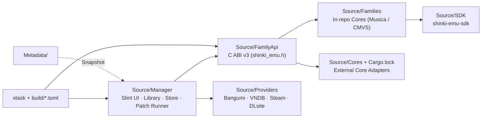

# Contributing Guide

Welcome to **Project-Shinkirou / ShinkiEMU**! Whether you are a player, translator, patch author, or systems developer, there is a clear path to help.

> [!NOTE]
> Project-Shinkirou does **not** accept financial donations. Starring the repository, submitting accurate compatibility reports, helping newcomers in Discussions, and contributing translations, patches, or pull requests are the best ways to support the project.

## Contribution Ladder

| Level | Audience | How you can help |
|---|---|---|
| **Level 1 · No code** | Players & testers | Submit a [Compatibility Report](https://github.com/Project-Shinkirou/ShinkiEMU/issues/new?template=compatibility.yml), help answer questions in [GitHub Discussions](https://github.com/Project-Shinkirou/ShinkiEMU/discussions), or file clear bug reports. |
| **Level 2 · Docs & i18n** | Writers & translators | Improve trilingual documentation in `docs/{zh-cn,en,ja}/` or update Manager UI `.po` translations. |
| **Level 3 · Patches** | Localization & script authors | Write sandboxed Luau patches bound to VNDB release fingerprints and submit via the [Patch Submission](https://github.com/Project-Shinkirou/ShinkiEMU/issues/new?template=patch.yml) form. |
| **Level 4 · Code & Cores** | Rust / C++ / UI developers | Improve Slint UI, store/metadata providers, SDK utilities, external-core adapters, or in-repo cores. |

## Repository Architecture



## Quick Local Checks

Run these commands from the repository root. Select only the Manager or core you changed.

```sh
cargo xtask matrix
cargo check --locked -p shinki-emu-manager
cargo check --locked -p shinki-emu-core-rfvp
cargo test --locked -p xtask -p shinki-emu-build
cargo xtask metadata validate
```

See [Build from Source](build-and-release.md) for prerequisites and [CONTRIBUTING.md](../../CONTRIBUTING.md) for the Windows/Android build and packaging gates.

## Manager UI Translations (`.po`)

Simplified Chinese is the source language for Slint `@tr("…")` and Rust `tr!("…")` strings. English and Japanese translations live in:

- `Source/Manager/shinki-emu-manager-ui-slint/translations/en/LC_MESSAGES/shinki-emu-manager-ui-slint.po`
- `Source/Manager/shinki-emu-manager-ui-slint/translations/ja/LC_MESSAGES/shinki-emu-manager-ui-slint.po`

Add every new or edited string to both `.po` files; missing or empty entries fail the build with `SHINKI_EMU_I18N_MISSING`. Keep one `msgid` per complete sentence, use `{}` or `{0}`/`{1}` for placeholders, and align terminology with `docs/en/` and `docs/ja/`.

## Branching, PRs & External Cores

- **Main repository PRs**: Branch from `main`, open a focused PR describing behavior changes and exact checks run, and update regressions and trilingual docs together.
- **External core PRs**: Target the adapter branch declared in [`build/cores.toml`](../../build/cores.toml) for the corresponding organization fork. Pin the merged commit in root [`Cargo.toml`](../../Cargo.toml), then refresh and commit [`Cargo.lock`](../../Cargo.lock). `ThirdParty/cpal` is the only submodule.
- **Writing or integrating a core**: Follow [shinkiemu-new-core](../../.agents/skills/shinkiemu-new-core/SKILL.md) and [shinkiemu-integrate-existing-core](../../.agents/skills/shinkiemu-integrate-existing-core/SKILL.md).

## AI / Agent-Assisted Contributions

Thoughtful AI-assisted contributions are welcome, and the repository ships structured workflows under [`.agents/skills/`](../../.agents/skills/). All PRs meet the same engineering bar:

1. You understand and can explain the changes.
2. Every reported build, check, and regression was genuinely executed against real backends.
3. Licensing, upstream attribution, and sensitive-data boundaries are strictly honored.

## Licensing & Sensitive Data Boundaries

- Preserve full author attribution, upstream provenance, and licenses; verify redistribution rights before adding dependencies or attachments.
- **Never commit** commercial game assets, scripts/text, commercial saves, keys, private configs, decoded exports, or unredacted logs. Automated tests use publicly licensed or synthetic fixtures only.
- Compatibility reports and Luau patches follow the review workflow in [Metadata & Patches](metadata.md).
