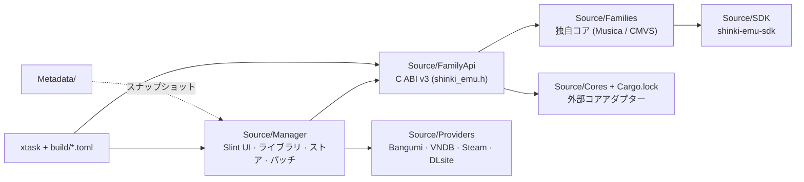

# コントリビュートガイド

**Project-Shinkirou / ShinkiEMU** コミュニティへようこそ！コードを書かない参加方法からコア開発まで、幅広い貢献を歓迎しています。

> [!NOTE]
> Project-Shinkirou では**金銭的な寄付を受け付けていません**。GitHub の Star、正確な互換性レポート、Discussions での助け合い、翻訳・パッチ・PR の投稿が最大の支援になります。

## 4 段階の参加ステップ

| ステップ | 対象 | 貢献できること |
|---|---|---|
| **Level 1 · コード不要** | すべてのプレイヤー | 所有作品の[互換性レポート](https://github.com/Project-Shinkirou/ShinkiEMU/issues/new?template=compatibility.yml)提出、[GitHub Discussions](https://github.com/Project-Shinkirou/ShinkiEMU/discussions) での質問回答、再現手順付きのバグ報告。 |
| **Level 2 · ドキュメント・翻訳** | 翻訳・執筆に関心のある方 | `docs/{zh-cn,en,ja}/` の改善、Manager UI（`.po`）の日本語・英語訳の拡充。 |
| **Level 3 · パッチ** | 翻訳・スクリプト制作者 | VNDB リリース指紋に紐付いたサンドボックス Luau パッチを[パッチ投稿フォーム](https://github.com/Project-Shinkirou/ShinkiEMU/issues/new?template=patch.yml)から提出。 |
| **Level 4 · 開発・コア移植** | Rust / C++ / UI 開発者 | Slint UI、ストア／メタデータ連携、SDK、外部コアアダプター、独自コアの開発。 |

## リポジトリ構成



## ローカル検証コマンド

リポジトリルートで実行し、変更した Manager またはコアだけを選びます。

```sh
cargo xtask matrix
cargo check --locked -p shinki-emu-manager
cargo check --locked -p shinki-emu-core-rfvp
cargo test --locked -p xtask -p shinki-emu-build
cargo xtask metadata validate
```

前提条件は[ソースからのビルド](build-and-release.md)、Windows／Android のビルド・パッケージ要件は [CONTRIBUTING.md](../../CONTRIBUTING.md) を参照してください。

## Manager UI 翻訳（`.po`）

UI の原文は簡体字中国語（`msgid`）で、日本語と英語の翻訳ファイルは以下にあります：

- `Source/Manager/shinki-emu-manager-ui-slint/translations/ja/LC_MESSAGES/shinki-emu-manager-ui-slint.po`
- `Source/Manager/shinki-emu-manager-ui-slint/translations/en/LC_MESSAGES/shinki-emu-manager-ui-slint.po`

文言を追加・変更した際は両方の `.po` へ同時反映してください（欠落や空文字は `SHINKI_EMU_I18N_MISSING` でビルド失敗します）。1 メッセージを完全な文とし、用語は `docs/ja/`・`docs/en/` に揃えてください。

## ブランチ・PR・外部コア規則

- **メインリポジトリ**：`main` からトピックブランチを切り、変更理由・再現手順・実行済みテストを明記して PR を作成します。
- **外部コア**：組織 fork の対象コアで、[`build/cores.toml`](../../build/cores.toml) に記載されたアダプターブランチへ PR を出します。マージ後はルートの [`Cargo.toml`](../../Cargo.toml) にコミットを固定し、更新した [`Cargo.lock`](../../Cargo.lock) もコミットします。サブモジュールは `ThirdParty/cpal` のみです。
- **新コア作成／移植**：リポジトリ内蔵ガイド [shinkiemu-new-core](../../.agents/skills/shinkiemu-new-core/SKILL.md)・[shinkiemu-integrate-existing-core](../../.agents/skills/shinkiemu-integrate-existing-core/SKILL.md) を参照してください。

## AI / エージェント支援による貢献

AI コーディング支援ツールの活用を歓迎しており、[`.agents/skills/`](../../.agents/skills/) に開発手順を整備しています。人間による執筆か AI 支援かを問わず、すべての PR に同一のレビュー基準を適用します：

1. 提出者が変更内容を十分に理解し説明できること；
2. ビルド・チェック・回帰テストが実際の環境で誠実に検証されていること；
3. ライセンス、アップストリーム表記、機密データ禁止ルールが厳守されていること。

## ライセンスと機密データの境界

- 作者表記・出典・ライセンスを正確に保持してください。
- 商用ゲームデータ、本文、セーブ、鍵、未加工ログのコミットは厳禁です。テストには公開ライセンス素材または自作フィクスチャのみを使用してください。
- 互換性レポートとパッチの投稿手順は[メタデータとパッチ投稿](metadata.md)を参照してください。
