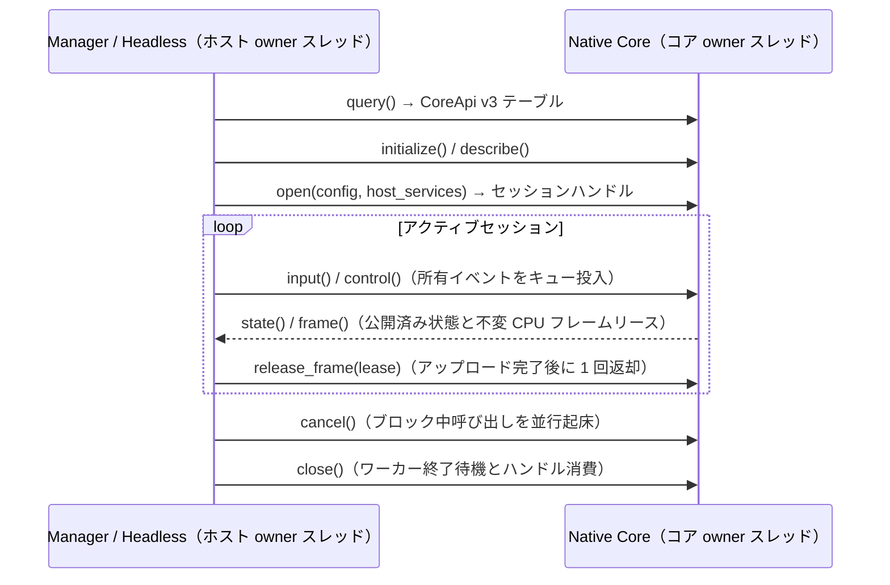

# コア ABI と SDK

## アーキテクチャとライフサイクル概要



| 機能ビット（`Descriptor.capabilities`） | 値 | 内容 |
|---|---|---|
| `CAP_NATIVE_SCRIPT_IDENTITY` | `64` | 変換済みスクリプトのハッシュ検証とセーブ・既読分離 |
| `CAP_CONFIGURED_FONT_PRIORITY` | `128` | スクリプトや復元状態より設定フォントを優先 |
| `CAP_NATIVE_EMBEDDED_TEXT` | `256` | ネイティブ SC でのオフライン埋め込み Unicode テキスト対応（Musica） |
| `CAP_NATIVE_NAME_RESOURCES` | `512` | ネイティブ SC からの名前定数読み取りと EXE 読み取り専用フォールバック |

## プロトコルとエントリーポイント

ネイティブプロトコルは `shinki.emu.native.c.v3` で、ABI の数値バージョンは **3** です。動的コアは `shinki_emu_query` をエクスポートし、静的統合では同じ形の Query 関数を登録します。Rust の契約は `Source/FamilyApi/shinki-emu-abi` にあり、生成される C ヘッダーは `include/shinki_emu.h` です。C++ はこのヘッダーを使い、ABI 定義を別に保守することはしません。Rust の型を変更したら、リポジトリのルートで cbindgen 0.29.2 によりヘッダーを再生成して一緒にコミットします。CI の tools ジョブは同じ 2 つのコマンドを実行し、コミットされたヘッダーが生成結果と異なると失敗します。

```sh
cargo metadata --locked --format-version 1 > .work/metadata.json
cbindgen --config Source/FamilyApi/shinki-emu-abi/cbindgen.toml --crate shinki-emu-abi --metadata .work/metadata.json --output Source/FamilyApi/shinki-emu-abi/include/shinki_emu.h Source/FamilyApi/shinki-emu-abi
```

`--metadata` を渡すのは、cbindgen 自身の `cargo metadata` 呼び出しが `Cargo.lock` を書き換えないようにするためです。

境界を越えるのは C レイアウトの値だけです。具体的には、バージョン付きヘッダー、長さ上限のある借用バイト列、不透明ハンドル、ステータスコード、関数ポインターです。Rust のコンテナや例外の巻き戻しは ABI を越えません。動的ライブラリと不変の descriptor ストレージは常駐したままです。query はバージョンと関数テーブルの出力ポインターを受け取り、未対応のバージョンでは出力を null にします。query は I/O を行わず、worker を起動せず、logger もインストールしません。

## ディレクトリ識別

`shinki_emu_manager_core::detection::detect_game_directory(&Path, &NativeCancellation)` は `Result<Vec<EngineDetection>, DetectionError>` を返します。結果は `family_id` と `format` のみで、インストール済みプラグインや native `FamilyProbeCandidate` に依存しません。同じ family は一件にまとめ、family ID 順に返します。複数 family の選択は呼び出し側が行い、空の配列は未識別です。family の識別、実装の互換性、実行成功は別々に扱います。

対象はルートと `Data`、`Data/pack`、`StartData`、`game`、`USRDIR` です。ディレクトリ名の大文字小文字は区別しません。リンクと特殊ファイルを除外し、列挙は 4,096 項目、読み込みは 1,024 ファイル、物理読み込みは合計 16 MiB、開いたファイルハンドルごとに 4 MiB までに制限します。再オープンした解析も合計上限を共有します。読み込みと解析の間でキャンセルを確認しますが、ブロック中の OS 呼び出しは中断できません。I/O、キャンセル、上限超過はエラーを返し、部分候補や未一致キャッシュに変換しません。破損・切り詰められた候補は除外して他のファイルを調べます。ルール変更時には `detection::CACHE_VERSION` を更新し、キャッシュはディレクトリ内容の変更も追跡する必要があります。
Select.ini の最初の有効な TAB 区切り append も解決し、範囲外のパスとリンクを拒否します。検証済み Musica 鍵で別名アーカイブと入れ子の配置を有界に探索し、パッチ受領書の profile/archive/loose-script パスを安全に解決します。PAZ の連続した `A`–`Z` ボリュームは同じ論理ストリームとして読みます。上記の上限は共通です。これは形式ごとの対応であり、エンジンが受け入れるすべての入力を実行なしに一意に識別できるという意味ではありません。

`build/cores.toml` の各 family を次の形式で確認します。

| Family ID | 確認内容 | 対象範囲 |
| --- | --- | --- |
| `fvp` | HCB/BCH システム記述子、エントリーポイント、タイトル境界、syscall レコード | magic はなく、拡張子は構造解析の入口にのみ使用 |
| `siglus` | Scene PCK/CHS 構造、任意の `pack_scn`、UTF-8/CP932 Select.ini の最初の有効 append | 活動ディレクトリが不明・危険な場合に後続項目へ切り替えない。鍵は起動時に検証 |
| `artemis` | PF2/6/8 の有界な完全索引、`system.ini`、リソース範囲 | プロジェクト項目のない PF は採用しない |
| `musica` | keys.v2、復号した PAZ0/1/2 索引と SC、別名アーカイブ、設定された loose script、連続ボリューム | 正しい鍵と上限内の完全リソースが必要。ディレクトリ外の秘密 profile は推測しない |
| `softpal` | 直接 Sv20 または PAC 索引内の Sv20 と入口。data.pac/csv.pac 内を含む archive.dat 初期 profile のパスも解決 | native bootstrap と同じ profile 0 を使用し、後続 profile に切り替えない。EXE/appid リスト、範囲外パス、非 PAC 形式は使用しない |
| `krkr` | XP3 索引、または Scripts.execStorage の字面参照と実ファイル内の KiriKiri builtin 呼び出し。コメント・文字列を除外 | 動的 loose TJS、曖昧なソース、EXE 内 XP3、独自方式は未識別 |
| `ethornell` | 候補ディレクトリ直下の BURIKO ARC20 索引、または `ipl._bp` を含む PackFile 索引とリソース範囲 | ブートスクリプトの展開や VM 互換性は検証しない |
| `cmvs` | CPZ3/5/6/7 の固定ヘッダーと索引範囲、または PS2A セグメント | CPZ1/2 は未識別。暗号化索引、checksum、profile は起動時に検証 |
| `lucifen` | ルートの `SCRIPT.LPK`（大文字・小文字を区別しない）、LPK1 ヘッダーと索引範囲 | 暗号化索引、`gameinit.sob`、起動リソースは選択したコアが起動時に検証 |
| `adv32` | ルートの `AdvData/MES/start.mes`（大文字・小文字を区別しない）、対応する MES 形式のマーカー、有効なエントリオフセット表 | 命令とエントリ位置の境界は選択したコアが起動時に検証 |
| `mages` | MPK v2 の有界な完全索引とリソース範囲 | family 識別は Impacto の実行 profile 対応を保証しない |
| `renpy` | RPA2/3、RPC2、または旧 zlib-RPYC の完全な pickle opcode 列が示す renpy.ast オブジェクト | バイトだけを調べ、pickle の import・構築・実行はしない。汎用 zlib/pickle、RPA1、ソースのみは未識別 |

ルールは pin された adapter と上流の解析実装から確認し、作品名は使用しません。Musica の PAZ 変換・索引解析と SC 解析は純粋な `shinki-emu-musica-format` で識別と再生が共有し、VM、ABI、GPU、音声に依存しません。Manager のスキャン・ライブラリ・コア一覧は Detector、生成された `static_core_catalog`、検証済み `core.json` を使い、ネイティブ provider を登録・query しません。静的関数表は選択した入口の索引だけで、Windows の任意機能 `static-cmvs` も同じ扱いです。

高度な設定、診断、起動を明示的に要求した場合だけ、owner が選択した plugin を非同期に有効化します。診断ではゲームを開きません。起動は選択コアだけを新しく probe し、open 前の再検証も維持します。常駐コアの更新には従来どおり再起動が必要で、別実装への自動フォールバックはありません。未知の plugin や単独ライブラリは自動 query せず、診断対象として表示します。

高度な設定の失敗理由は現在のゲームと選択 plugin、既定設定の失敗は現在の既定 plugin に関連付けます。グローバル通知を閉じたり別のゲームを表示しても元の理由を保持し、再試行・成功・実装の変更時に対象の理由を消去または切り替えます。

schema 7 の game ID、保存先、family、任意の `GameSettings.emulator_id` は保持します。family/format と未検証の receipt 設定文字列は既存の `app_state` に保存し、偽の plugin ID や重複ゲームを作りません。キャッシュ形式 2 は Detector の結果を保存し、`detection::CACHE_VERSION` と有界な前後のリソース指紋で失効します。古いキャッシュは miss になり、キャンセル・I/O・読み取り上限エラーを NoMatch や負のキャッシュに変換しません。

スキャンが失敗しても owner が利用可能なら、同じアプリのセッションで識別を再試行できます。既存の登録は保持し、コアを初期化しません。owner や一覧準備自体の失敗には再起動が必要です。

## ライフサイクル

1. **query** は不変の `CoreApi` テーブルを取得し、バージョン、サイズ、必須の関数ポインターを確認します。
2. **initialize** は通常のコア操作の前に診断機能を接続します。
3. **describe** は family/plugin の識別子、バージョン、フォーマット、型付き設定、能力を返します。CPU surface は必須の能力です。0 以外の描画サイズは、descriptor で宣言され、その範囲内にある場合に限り有効です。
4. **probe** はゲームディレクトリを調べます。`NO_MATCH` は正常な結果です。返される文字列はモジュールのストレージを借用しており、次の通常呼び出しまで有効なので、ホストは必要なメタデータを先にコピーします。
5. **open** は設定を検証してネイティブセッションを作成します。失敗時はリソースを片付けて null ハンドルを返します。成功時は session/context/output の識別子と surface のメタデータを返します。
6. **input** は入力を順序付きの所有型イベントとしてコピーし、キューに入れます。**control** は一時停止、再開、または保持済みで安全に再試行できる操作を要求します。ポインター座標は、現在表示しているフレームのラスターピクセルとその識別子に対応します。
7. **state** と **frame** は公開済みの状態と画面を読み取るだけで、VM を進めません。失敗したセッションは型付きのエラーを持ちます。ホストが再試行を提示するのは、コアが安全と宣言している場合だけです。
8. **cancel** は並行して呼び出せます。ブロック中のネイティブサービスを起こす必要があり、キャンセル対象の操作の後ろで待ってはいけません。
9. **close** は結果にかかわらずハンドルを消費し、戻る前に worker とコールバックの終了を待ちます。ホストは新しい cancel を止め、実行中の cancel が戻るのを待ってから close します。
10. **extension** は名前とバージョンを持つ C テーブルをネゴシエートします。未対応の場合は `UNSUPPORTED` と空の出力を返します。任意の `shinki.module_owner` は、セッションをまたぐ実際のリソースに owner を提供します。この owner はモジュールの owner スレッドで作成され、すべてのセッションが終わったあとに破棄されます。

明示的に起動する Android 動的コアは `shinki.emu.android_context` v1（`AndroidContextV1`、ヘッダーは ABI v3）を公開できます。ホストは `initialize` の前に、Java VM とプロセスの存続中有効なアプリケーションコンテキストの JNI グローバル参照を渡します。Activity やスレッド固有の `JNIEnv*` は渡しません。同じポインターでの再登録は安全です。検索、インストール、組み込みの静的登録ではこの拡張を呼びません。

通常の ABI 呼び出しは、ホストの owner スレッドで直列に実行されます。VM の進行、描画と音声のスケジューリング、リソースのライフサイクルは、コア自身のネイティブ owner が担当します。Manager が提供するのは入力、制御、ホストサービスだけで、advance コールバックはありません。キャンセルと epoch のチェックにより、古いセッションや古い出力世代から遅れて届いた結果は拒否されます。

共有 Rust 診断ブリッジは元のイベントを一度だけ転送します。ホストのコールバックが同じ静的リンクの tracing subscriber にイベントを出力しても、そのネストしたイベントを ABI 経由で再転送しません。スレッドローカルのガードはフィールドの整形とコールバックを保護し、通常の復帰でも巻き戻しでも解除されます。他のスレッドと後続イベントは独立して処理されます。`shinki-emu-abi/diagnostic-bridge` を使うすべてのコアに適用され、ログレベルや worker のスタック容量は変更しません。

## オプションの GPU シーンサービス

`OpenRequestGpuV1` は `OpenRequestTextV1` 全体を先頭に置き、末尾に `GpuSceneServiceV1` のポインターを追加します。コアはリクエストの大きさを確かめてから、テーブルのバージョン・大きさ・コールバックを確認します。サービスがない場合や `create` が `UNSUPPORTED` を返す場合は、セッション開始前に CPU フレームを選びます。ABI v3 とコアのエントリーポイントは変わりません。

Manager が WGPU のデバイスとキューを所有し、コアはセッション内で有効な不透明なターゲット ID と C レイアウトの描画コマンドを使います。SDK は呼び出し中だけコマンドを貸し出し、画像や字形を保持するための retain/release を提供します。Manager は自身のテクスチャに描画し、そのまま表示するか、フィルターの入力に使います。通常の描画でデバイス、Rust オブジェクト、フレームバッファーの画素は ABI を越えません。出力の世代はホストが割り当てるため、ターゲットを交換しても巻き戻りません。

`shinki_emu_sdk::gpu_scene::SceneOutput` はセッション開始時に出力方式を選び、ターゲットを保持します。ターゲットの再作成で出力方式は変わりません。コマンド全体が v1 に収まるコアは `SceneRequirements::Sprites` を選び、`submit(&frame, logical)` を呼びます。従来の CPU リースを発行するのは、オフスクリーン描画で画素が返った場合だけです。Musica はこの経路を使い、セーブのサムネイルなどに必要な時だけ `capture()` します。

`GpuSceneServiceV2` は変更のない v1 の末尾に `present_raster` を追加し、テーブルの大きさでその存在を通知します。先頭のバージョンは 1 のままです。CPU で描画済みのエフェクトをこのコールバックに渡しても、基本の CPU リース API には切り替わりません。二つのコールバックはターゲットのシーケンス番号とホストの出力世代を共有します。ホストは不変のラスターデータを保持し、表示時だけアップロードします。ハードウェア合成を有効にした ADV32 は `SpritesWithNativeRaster` を選びます。通常フレームはホストの GPU 上に留まり、画面破砕エフェクトの開始時に限って必要に応じ一度だけキャプチャします。CPU でのセーブ画像生成は従来どおりです。

古いホスト、headless、現行 Android の Skia/Vulkan、OpenHarmony のソフトウェア表示では、必要なサービスがなければ従来のオフスクリーン描画と CPU リースをセッション全体で使います。ツリー内の CMVS は SDK のオフスクリーン経路に固定します。プロトコルにないカメラ、メッシュ、射影メッシュ、クロスフェードに加え、親子レイヤーのマスクは中間パスとバイト精度の alpha ルックアップを必要とします。ホストでの描画へ移すには、その結果を同じデバイス上のテクスチャとして元の描画順に挿入できなければなりません。Lucifen は変更可能な CPU キャンバスの不変スナップショットを既存の `native::lease_cpu` API で公開し、シーンコマンドは生成しません。

## 変換結果の互換性

既存の `Descriptor.capabilities` に任意の意味ビットを追加します。ABI バージョン 3、C レイアウト、fingerprint は変更しません。

- `CAP_NATIVE_SCRIPT_IDENTITY`（64）：明示された変換スクリプトの hash を検証し、そのセーブ・既読を分離します。marker のないゲームは従来の保存先を使います。
- `CAP_CONFIGURED_FONT_PRIORITY`（128）：設定したフォントを、スクリプトや復元状態の優先フォントより先に使用します。ruby と UI テキストも対象です。
- `CAP_NATIVE_EMBEDDED_TEXT`（256）：ネイティブ SC の表示オペランドが Unicode scalar リテラルを扱い、実行時翻訳表なしで埋め込み訳文を表示します。Musica レシピは 256、RFVP の GBK/統一フォント用レシピは 192 を要求し、同じ descriptor/receipt 検証を使います。
- `CAP_NATIVE_NAME_RESOURCES`（512）：ネイティブ SC の姓名定数と元の表示・履歴規則を使い、リソースがない場合だけ EXE を読み取り専用で参照します。Yorino は 256|512=768 を要求し、EXE は変更しません。

Luau レシピは profile の `plugin_id`、`configuration` と並べて `required_capabilities = 192` を指定でき、receipt が要件を保持します。インポートは識別済みゲームと設定文字列だけを保存します。高度な設定の明示的な準備や起動時に、選択した実際の descriptor で型・機能を検証し、成功後にゲームを開きます。自動インポートは変換後に変更された receipt を拒否します。機能不足はコア更新として案内し、未知の要件は profile を無効とします。バージョン名やファイル名から機能を推測しません。旧 profile の省略値は 0 で、新しい receipt も 0 を省略します。

## テキスト置換のレベル

判断基準は descriptor の能力ビットだけです。`CAP_TEXT_HOOK` がなければ **none**、`CAP_TEXT_HOOK` だけなら **synchronous**、`CAP_TEXT_HOOK | CAP_ASYNC_TEXT` の両方があれば **async-v1** です。`CAP_ASYNC_TEXT` だけを宣言しても無効です。現在バージョンを固定している外部コア 9 個はすべて none を宣言しています。外部コアは、自身のスケジューリング方式を保ったまま同期置換を採用できます。SDK コアかどうかは所有関係で決まります。Musica は SDK の自社コアで、Artemis は SDK の音声を使っていても外部コアです。CMVS は独立したワークツリーで保守されています。

ABI バージョンは **3** のままです。`OpenRequestTextV1` は基本の `OpenRequest` をそのまま含み、末尾に `AsyncTextServiceV1` へのポインターだけを追加します。サービステーブルは自身のバージョン 1 とサイズを持ちます。ホストは基本ヘッダーの size を拡張構造体のサイズに設定します。コアはまず size が拡張部分を含むかを確認し、そのうえでサービスのバージョン、サイズ、コールバックを検証します。null ポインターは置換の無効化を意味します。既存の外部バイナリは、レイアウトが変わらない `HostServices.text` の同期コールバックを引き続き使います。async-v1 コアは同期パスにフォールバックしません。

`submit` は戻る前に長さ上限のあるテキスト項目をコピーし、完了するまで `poll` は即座に `PENDING` を返します。待つのはテキストの送りだけで、画面、アニメーション、入力、音声は動き続けます。結果には置換の意味、テキスト項目 ID、`(session_epoch, context_epoch, request_id)` の識別子が保持されます。request ID は同じ context 内で増加します。未確認の同じリクエストを再送しても、二重には実行されません。`CAPACITY` は呼び出し側のバッファに必要な容量を返し、provider や拡張を再実行しません。完了した結果は `acknowledge` まで保持されます。`cancel` は指定したリクエストだけを破棄し、`invalidate` は context を進めて、古いリクエスト、コンテキスト、provider のキャッシュを破棄します。コールバックはネットワークやスクリプトの完了を待ってはいけません。

Manager の 2 つのパスは provider の `AsyncTranslationService` を共有し、同期互換コールバックも同じ結果を待ちます。Musica は自身の pump で一度だけ submit し、保持したバッファで poll するため、音声は止まりません。Enter、スペース、メインボタンのクリック、Ctrl を押すと、完了待ちの翻訳をスキップし、置換入力の原文を表示します。この入力は消費されるため、その行まで同時に送られることはありません。スキップモードでも完了待ちの翻訳はスキップされます。スキップ、ロード、巻き戻し、終了では遅れて届いた結果を破棄します。失敗時の再試行はテキストイベントと識別子を保持し、VM を再実行しません。


## CPU フレームリース

Ready 状態の `FrameSurface` には、実際のサイズ、stride、ピクセル・色・行順のメタデータ、フレームの識別子、不変の CPU リースが 1 つ含まれます。受け取る前にメタデータと epoch を検証します。Pending と Unchanged はピクセルの所有権を持ちません。表示時は宣言されたラスター/論理ジオメトリと色の解釈に従います。

`frame` の戻り値は、Pending と Unchanged を含めて常にセッションの実際の識別子を持ちます。`identity.session_epoch` は `open` に渡された `OpenRequest.session_epoch`、`identity.output_epoch` は `open` が返し `state` が報告する 0 以外の output epoch で、`reserved` は 0 です。最初のフレームを公開する前の Pending は generation 0 でもかまいませんが、リースは空のままにします（ピクセルと owner は null、長さ 0、release コールバックなし）。Unchanged は呼び出し側が渡した 0 以外の generation を返します。Ready には 0 以外の generation と、ちょうど `stride × ラスターの高さ` バイトのリースが必要です。ホストはすべての結果を `FrameSurface::validate_cpu(session_epoch)` で検証してから受け取るため、識別子がすべて 0 の Pending は `STALE_CONTEXT`、output epoch が 0 なら `INVALID_ARGUMENT` で失敗します。`shinki_emu_sdk::native::lease_cpu` はリースを作るだけで、未返却のリースが 3 つあるときは `None` を返します。識別子はコア自身が設定し、その場合は Pending を返します。コアのテストでは、返したすべての surface を `validate_cpu` で確認してください。

各リースは一度だけ返却し、実際のアップロード API がピクセルを読まなくなってから返却します。owner と release コールバックはセッションの終了後も有効で、別のスレッドからも呼び出せます。返却処理では VM、デバイス、ウィンドウ、session、ホストサービスに触れてはいけません。フレームを保持してもゲームセッションは延長されず、コアが貸し出し中のピクセルを上書きすることもできません。ABI の `CpuFrame` ラッパーは、検証に失敗した場合でも受け取ったリースを返却します。

## SDK の役割

`Source/SDK/shinki-emu-sdk` は共通の仕組みを提供するもので、別のゲームランタイムを作るものではありません。`runtime` の値はプロセス内部でのみ使われます。`native` は設定の検証、epoch、キャンセル、遅れて届いたウィンドウ結果の拒否、独立した CPU リースを共通化し、`native_input` は VM を呼ばずに長さ上限のある入力をコピーします。`NativeAudioOutput`/`NativeAudioConverter` は、コアが所有するデバイススレッドに使われます。`NativeAudioOutput::progress()` は、受け付けたフレーム数と実際に再生されたフレーム数を 48 kHz のソース時間軸で返します。再生フレーム数からはデバイス遅延とリサンプラー遅延を差し引いてあり、コアはこれでメディアクロックを進めます。`progress_reader()` が返す `NativeAudioProgressReader` は複製でき、デバイススレッドが書き込み中でも待機中でも、別のスレッドから同じ時間軸を読めます。`write` は任意の長さを受け付け、デバイスブロックに満たない端数は次回へ持ち越します。デバイススレッドが待機に入る前に `flush()` を呼ぶと、受け付けた全フレームが再生まで届きます（詰めた無音も受け付け済みとして数えます）。ミキシング、メディアクロック、ネイティブのセーブ形式、ゲームのルールは引き続き各コアが担当します。具体的な API は [SDK](https://github.com/Project-Shinkirou/ShinkiEMU/tree/main/Source/SDK/shinki-emu-sdk) を参照してください。

## コアパッケージ

パッケージ内のコアディレクトリ名は、ライブラリファイルの stem と同じです。

```text
<library-stem>/
  core.json
  source-commit.txt          # 公式の製品ビルド
  shinki_emu_<core>.dll       # または libshinki_emu_<core>.so/.dylib
  Resources/                 # ネイティブコアが必要とする場合
  licenses/
  <ネイティブ依存ファイル>
```

`core.json` は `shinki.emu.core_package.v1` を使い、`plugin_id`、`library`、`version`、`abi`、ファイルパスと SHA256 を記録します。マニフェストは自身を除くすべてのパッケージファイルを対象とします。ライブラリの名前には `shinki_emu_`、query には `shinki_emu_query` を使います。パッケージングは不正なパス、リンク、大文字小文字の衝突を拒否し、新しいディレクトリにだけ出力します。Manager はインストール前にパッケージを検証します。コマンドは[ビルドとリリース](build-and-release.md)を参照してください。

公式コアの製品ビルドは `source-commit.txt` に Git コミットを記録します。ASCII の小文字 16 進数 40 バイトで、改行は付けません。`core.json` の `files` に SHA-256 を記録するため、従来の Manager でも v1 のフィールドを読み取れます。同梱のカタログが公式コアを識別し、公式リリースカタログの SHA-256 とサイズでアーカイブを検証します。Manager に表示するコミットはこのファイルから読み取ります。Android の公式コアには検証済みのファイルが必要です。OHOS に同梱する Musica は、コミットが Manager のビルドと一致する場合にのみ使用できます。このファイルがない旧デスクトップパッケージもインストールでき、バージョンのみを表示します。

外部パッケージの `identity` には元の上流と Cargo が固定した組織 fork のコミットを記録し、`version` は計算した識別子と一致させます。旧パッケージには `identity` がなく、元の SemVer を保持します。Manager は配置前に plugin、version、identity をカタログと照合し、上流とアダプターの完全なラベルを表示します。C ABI と descriptor の版は独立しています。[版識別子の規則](release-runbook.md#パッケージングとリリース)を参照してください。
