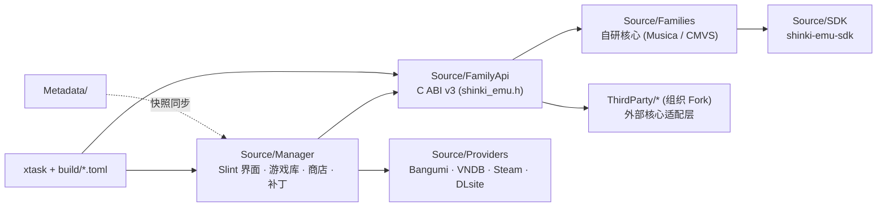

# 贡献指南

欢迎加入 **Project-Shinkirou / ShinkiEMU** 社区！无论你是热心玩家、译者、补丁作者还是系统工程师，都可以找到适合自己的参与方式。

> [!NOTE]
> Project-Shinkirou **暂不接受资金捐赠**。点亮 Star、提交准确的实测兼容性报告、在 Discussions 帮助新人，以及贡献翻译、补丁或代码 PR，就是对项目最宝贵的支持。

## 四级贡献阶梯

| 阶梯 | 适合人群 | 可以做什么 |
|---|---|---|
| **Level 1 · 零代码参与** | 所有玩家 | 实测你拥有的游戏并提交[兼容性报告](https://github.com/Project-Shinkirou/ShinkiEMU/issues/new?template=compatibility.yml)；在 [GitHub Discussions](https://github.com/Project-Shinkirou/ShinkiEMU/discussions) 交流与解答新人问题；反馈清晰的 Bug 复现步骤。 |
| **Level 2 · 文档与翻译** | 语言与文档爱好者 | 润色 `docs/{zh-cn,en,ja}/` 三语文档；补充 Manager 的英/日文界面翻译（`.po`）。 |
| **Level 3 · 补丁生态** | 汉化与脚本作者 | 编写绑定 VNDB 发行指纹的沙箱 Luau 补丁，并通过[补丁投稿表单](https://github.com/Project-Shinkirou/ShinkiEMU/issues/new?template=patch.yml)提交审核。 |
| **Level 4 · 代码与核心** | Rust / C++ / UI 开发者 | 改进 Manager UI（Slint）、完善商店/元数据 Provider、修复 SDK 问题、维护外部核心适配或开发新原生核心。 |

## 仓库架构速览



## 快速本地开发检查

在仓库根目录通过 `cargo xtask` 运行检查与测试（按实际修改组件选择，避免拉起无关原生依赖图）：

```sh
cargo xtask doctor --target x86_64-pc-windows-msvc
cargo xtask check --target x86_64-pc-windows-msvc --manager
cargo xtask check --target x86_64-pc-windows-msvc --core rfvp
cargo xtask test --manager
cargo xtask test --core rfvp
cargo xtask test
cargo xtask metadata validate
```

详细环境依赖与跨平台构建指南见[从源码构建](build-and-release.md)。

## 界面翻译（`.po`）

Manager 以简体中文为源语言（Slint `@tr("…")` 与 Rust `tr!("…")` 均以中文原文为 `msgid`），英文和日文译文位于：

- `Source/Manager/shinki-emu-manager-ui-slint/translations/en/LC_MESSAGES/shinki-emu-manager-ui-slint.po`
- `Source/Manager/shinki-emu-manager-ui-slint/translations/ja/LC_MESSAGES/shinki-emu-manager-ui-slint.po`

修改或新增界面文字时请同步补齐两份 `.po` 文件（缺失或空译文会触发 `SHINKI_EMU_I18N_MISSING` 报错）。请保持一条 `msgid` 为完整句子、参数使用 `{}` 或 `{0}`/`{1}`、术语与 `docs/en/` 和 `docs/ja/` 保持一致。

## 分支、PR 与外部核心规则

- **主仓 PR**：从 `main` 切出聚焦的功能分支，说明改动动机、复现步骤与实际运行的验证命令；源码、行为回归测试与三语文档同步更新。
- **外部核心 PR**：外部核心的适配改动提交到对应组织 fork（`Project-Shinkirou/<core>`）的 `shinki` 分支，合并后再在主仓 `build/cores.toml` 更新 `[cores.source].rev` 完整提交哈希。外部核心不是 Git 子模块，主仓唯一子模块为 `ThirdParty/cpal`。
- **开发新核心或接入外部引擎**：仓库内置了完整指导手册 [shinkiemu-new-core](../../.agents/skills/shinkiemu-new-core/SKILL.md) 与 [shinkiemu-integrate-existing-core](../../.agents/skills/shinkiemu-integrate-existing-core/SKILL.md)。

## AI / Agent 辅助贡献说明

我们欢迎合理借助 AI 编程助手提升开发效率，并提供了仓库级工作流技能 [`.agents/skills/`](../../.agents/skills/)。所有 PR 均遵循统一的工程审查标准：

1. 提交者充分理解改动逻辑并能回应审查意见；
2. 所有声称通过的构建、检查与回归测试均为真实运行结果，不跳过真实后端或伪造通过记录；
3. 严守许可合规、上游署名与敏感数据边界。

## 许可与敏感数据红线

- 保留完整的原作者署名、上游来源与许可证；引入任何新依赖或随包素材前核实分发授权。
- **严禁提交**商业游戏资源、剧本正文、商业存档、解密密钥、私有配置、解码导出文件或未脱敏日志。自动化测试只使用公开授权或自造夹具。
- 兼容性报告与 Luau 补丁流程详见[元数据与补丁贡献](metadata.md)。
