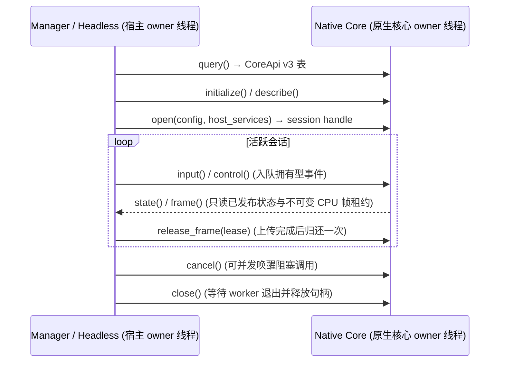

# 核心 ABI 与 SDK

## 架构与调用总览



| 能力位（`Descriptor.capabilities`） | 数值 | 含义 |
|---|---|---|
| `CAP_NATIVE_SCRIPT_IDENTITY` | `64` | 校验转换脚本 hash，隔离对应存档与既读命名空间 |
| `CAP_CONFIGURED_FONT_PRIORITY` | `128` | 配置字体优先于脚本或恢复状态中的首选字体 |
| `CAP_NATIVE_EMBEDDED_TEXT` | `256` | 原生 SC 支持离线嵌入 Unicode 译文（Musica 配方） |
| `CAP_NATIVE_NAME_RESOURCES` | `512` | 从原生 SC 读取姓名常量并只读回退 EXE |
| `CAP_AUTHORED_GALLERY_CLIP` | `1024` | 按逻辑矩形裁剪鉴赏布局图层 |

## 协议与入口

原生协议为 `shinki.emu.native.c.v3`，ABI 数值版本为 **3**。动态核心导出 `shinki_emu_query`，静态集成注册相同形状的 Query 函数。Rust 契约位于 `Source/FamilyApi/shinki-emu-abi`，生成的 C 头文件为 `include/shinki_emu.h`。C++ 使用这份头文件，不另行维护 ABI 定义。改动 Rust 类型后，在仓库根目录用 cbindgen 0.29.2 重新生成头文件并一起提交；CI 的 tools job 跑同样两条命令，提交的头文件与生成结果不一致就失败：

```sh
cargo metadata --locked --format-version 1 > .work/metadata.json
cbindgen --config Source/FamilyApi/shinki-emu-abi/cbindgen.toml --crate shinki-emu-abi --metadata .work/metadata.json --output Source/FamilyApi/shinki-emu-abi/include/shinki_emu.h Source/FamilyApi/shinki-emu-abi
```

传入 `--metadata` 是为了让 cbindgen 自己的 `cargo metadata` 调用不去改写 `Cargo.lock`。

边界只传 C 布局值，包括版本头、有界借用字节、不透明句柄、状态码和函数指针；Rust 容器及异常展开不跨 ABI。动态库及不可变 descriptor 存储保持驻留。query 接收版本和函数表输出指针；不支持的版本将输出置空。query 不执行 I/O、不启动 worker，也不安装 logger。

## 目录识别

`shinki_emu_manager_core::detection::detect_game_directory(&Path, &NativeCancellation)` 返回 `Result<Vec<EngineDetection>, DetectionError>`。匹配只含 `family_id` 和 `format`，不依赖已安装插件，也不使用 native `FamilyProbeCandidate` 报告。每个家族最多一项，按 family ID 排序；多个家族交调用方选择，空数组表示未识别。家族识别、实现兼容性和实际运行成功分开判断。

识别范围是根目录及 `Data`、`Data/pack`、`StartData`、`game`、`USRDIR`，目录名不区分大小写。跳过链接和特殊文件，最多枚举 4,096 个条目、读取 1,024 个文件，总物理读取上限 16 MiB，每个打开的文件句柄累计读取额度 4 MiB；重新打开的解析阶段仍共用总额度。读取和解析阶段之间检查取消；阻塞中的文件系统调用不能被强行中断。真实 I/O 失败、取消和读取超限返回错误，不返回部分候选，也不能写成未匹配缓存。坏格式和截断候选不命中，但继续检查其他文件。规则变更更新 `detection::CACHE_VERSION`，缓存还须跟踪目录内容变化。
还会解析 Select.ini 首条合法 TAB 分隔记录的活动 append，拒绝越界和链接路径。验证过的 Musica 密钥可用于有界发现归档别名及嵌套别名；补丁回执提供受限的 profile/archive/loose-script 路径。PAZ 的连续 `A`–`Z` 分卷按同一逻辑流读取，沿用上述预算。各项是具体格式覆盖，不代表能在不执行程序的条件下唯一识别引擎接受的所有输入。

`build/cores.toml` 中各家族的识别依据如下：

| Family ID | 检查内容 | 覆盖边界 |
| --- | --- | --- |
| `fvp` | HCB/BCH 系统描述偏移、入口、标题边界和 syscall 记录 | 无固定 magic；后缀只决定是否尝试结构解析，不能单独命中 |
| `siglus` | Scene PCK/CHS 结构、可选 `pack_scn`，以及 UTF-8/CP932 Select.ini 的首条合法 append | 活动目录缺失或不安全时不回退到后续条目；密钥由启动检查 |
| `artemis` | PF2/6/8 有界完整索引、`system.ini` 条目及资源范围 | 没有项目入口的 PF 归档不入库 |
| `musica` | keys.v2、解密 PAZ0/1/2 索引和 SC；支持归档别名、配置的散装脚本、连续分卷 | 需要正确密钥和预算内完整资源；目录输入无法推断保存在目录外的私有 profile |
| `softpal` | 直接 Sv20 或 PAC 有界索引中的 Sv20/入口；解析 archive.dat 初始 profile 路径，包括 data.pac/csv.pac 内的清单 | 遵循 native bootstrap 的 profile 0，不替换后续 profile，不用 EXE/appid 白名单；越界路径和非 PAC 封装保持未知 |
| `krkr` | XP3 索引，或 Scripts.execStorage 字面启动引用及实际目标中的 KiriKiri builtin 调用，排除注释/字符串 | 动态计算 loose TJS、歧义源码、EXE 内 XP3 和自定义归档保持未知 |
| `ethornell` | 候选目录直属文件中的 BURIKO ARC20 索引，或含 `ipl._bp` 的 PackFile 索引，以及资源范围 | 不解压引导脚本，不保证 VM 兼容 |
| `cmvs` | CPZ3/5/6/7 固定头和索引范围，或 PS2A 段范围 | CPZ1/2 保持未知；加密索引、校验和、profile 兼容性留给启动检查 |
| `lucifen` | 根目录的 `SCRIPT.LPK`（不区分大小写）、LPK1 文件头和索引范围 | 加密索引、`gameinit.sob` 和启动资源由选定核心在启动时校验 |
| `adv32` | 根目录的 `AdvData/MES/start.mes`（不区分大小写）、受支持的 MES 版本标记和有效的入口偏移表 | 指令和入口是否落在指令边界上，由选定核心在启动时校验 |
| `mages` | MPK v2 有界完整索引和资源范围 | MPK 证明家族，不代表 Impacto 选定运行 profile 可用 |
| `renpy` | RPA2/3、RPC2，或旧 zlib-RPYC 中完整 pickle opcode 流声明的序列化 renpy.ast 对象 | 只检查字节，不导入、构造或执行 pickle；通用 zlib/pickle、RPA1、纯源码保持未知 |

规则来自固定提交的 adapter 和上游格式解析器，不按作品名匹配。Musica 的 PAZ 变换、索引解析和 SC 解析由识别与运行共用，位于不依赖 VM、ABI、GPU 或音频的 `shinki-emu-musica-format`。Manager 扫描、游戏库和核心列表使用 Detector、只含元数据的 `static_core_catalog` 和已校验的 `core.json`，不注册或查询原生核心。只有开启已弃用 feature 的本地兼容构建才会生成静态入口表。

用户显式准备高级配置、诊断或启动时，owner 才异步激活选定 plugin；诊断不打开游戏。启动使用选定核心的新鲜 probe，并保留 open 前的再次校验。已驻留核心及暂存更新仍遵守重启语义，不自动换用其他实现。未知 plugin 和裸库保留可见诊断，不靠自动 query 补全信息。

高级配置失败原因关联当前游戏与所选 plugin，默认配置失败关联当前默认 plugin，不读取全局通知。关闭通知或查看另一部游戏不会丢失原条目的原因；重试、成功或更换实现时，再清除或切换对应原因。

现有 schema 7 的 game ID、路径、family 和可空 `GameSettings.emulator_id` 原样保留。每个游戏的 family/format 识别结果、待验证的回执字符串使用既有 `app_state` 保存，不伪造 plugin ID，不重复建库。缓存格式 2 保存 Detector 结果，以 `detection::CACHE_VERSION` 和有界的资源前后指纹失效，不再依赖核心清单。旧缓存作未命中；取消、I/O 和读取上限错误不会变成 NoMatch 或负缓存。

扫描失败但 owner 仍可用时，可在同一会话中重试识别，已有记录保留，重试不初始化核心。owner 或清单启动失败仍需重启。

## 生命周期

1. **query** 取得不可变 `CoreApi` 表，检查版本、大小和必需函数指针。
2. **initialize** 在普通核心操作之前接入诊断。
3. **describe** 返回 family/plugin 标识、版本、格式、类型化配置和能力。CPU surface 是必需能力；非零渲染尺寸须由 descriptor 声明并落在范围内。
4. **probe** 检查游戏目录，`NO_MATCH` 属于正常结果。返回字符串借用模块存储，到下一次普通调用前有效，宿主先复制所需元数据。
5. **open** 校验配置并创建原生会话。失败时清理资源并返回空句柄；成功返回 session/context/output 身份和 surface 元数据。
6. **input** 将输入复制为有序拥有型事件并入队；**control** 请求暂停、恢复或已保留且可安全重试的操作。指针坐标对应当前显示帧的光栅像素及身份。
7. **state**、**frame** 读取已发布状态和画面，不推进 VM。失败会话携带类型化错误；只有核心声明安全时，宿主才提供重试。
8. **cancel** 可以并发调用，必须唤醒阻塞中的原生服务，不能排在被取消操作后面等待。
9. **close** 无论返回何种结果都消耗句柄；返回前等待 worker 和回调结束。宿主先阻止新 cancel，再等已有 cancel 返回，最后 close。
10. **extension** 协商具名、带版本的 C 表。不支持时返回 `UNSUPPORTED` 和空输出。可选 `shinki.module_owner` 为真实跨会话资源提供 owner，由模块 owner 线程创建，在所有会话结束后销毁。

可选的 `shinki.emu.config_paths` v1 扩展为已有路径字段提供文件类型筛选和只读校验。宿主在激活核心时复制有长度上限的元数据，并在 owner 线程上将文件选择器返回的绝对路径交给核心校验。校验失败时保留原有设置。未提供扩展的核心仍使用不筛选文件类型的选择器，并在打开会话时校验。ABI v3 描述符和配置字段的布局不变。

显式激活 Android 动态核心时，宿主可以协商 `shinki.emu.android_context` v1（`AndroidContextV1`，表头沿用 ABI v3）。在 `initialize` 前，宿主传入 Java VM 和进程生命周期内有效的 Application JNI 全局引用。不能传入 Activity 或线程局部的 `JNIEnv*`。同一组参数可重复绑定。发现、安装和内置静态注册均不调用此扩展。

普通 ABI 调用在宿主 owner 线程串行执行。核心自己的原生 owner 负责 VM 推进、渲染/音频调度及资源生命周期。Manager 只提供输入、控制和宿主服务，没有 advance 回调。取消和 epoch 校验会拒绝旧会话或旧输出代次的迟到结果。

共享 Rust 诊断桥对每条原始事件只转发一次。宿主回调向同一个静态链接 tracing subscriber 发出的嵌套事件，不会再次经 ABI 回传。线程局部保护覆盖字段格式化和回调，在返回或异常展开时复位；其他线程和后续事件不受影响。所有使用 `shinki-emu-abi/diagnostic-bridge` 的核心共用这项行为，无需改变日志级别或 worker 栈预算。

## 可选 GPU 场景服务

`OpenRequestGpuV1` 保留完整的 `OpenRequestTextV1` 前缀，末尾新增 `GpuSceneServiceV1` 指针。核心先检查请求大小，再检查服务表的版本、大小和回调。宿主未提供服务，或 `create` 返回 `UNSUPPORTED`，就在开局时选用原有 CPU 帧。核心仍须支持旧宿主和 headless。ABI v3 和核心入口不变。

Manager 持有 WGPU 设备和队列。核心只拿到当前会话内有效的目标 ID，通过 C 布局提交有序绘制命令。SDK 在调用期间借出命令；宿主可通过 retain/release 保留不可变的贴图和字形。Manager 在自己的纹理上绘制，直接采样，或把纹理交给滤镜。普通出帧不跨 ABI 传设备、Rust 对象或帧缓冲像素。帧代次由宿主分配；换目标不重置代次，关闭后的提交会被拒绝。

`shinki_emu_sdk::gpu_scene::SceneOutput` 在开局时选定出帧路径，持有绘制目标，重建目标时不重新协商。整套绘制命令都能用 v1 表达的核心以 `SceneRequirements::Sprites` 打开，再调用 `submit(&frame, logical)`。只有离屏分支返回的像素才走原有 CPU 帧租约；宿主 GPU 分支只在确实需要像素时调用 `capture()`。Musica 用这套接口出帧，并显式捕获存档缩略图。

`GpuSceneServiceV2` 在原样保留的 v1 表尾部加上 `present_raster`，用表大小声明支持，前缀的版本仍为 1。已经在 CPU 上画好的特效可以走这个回调，不会改用基础 CPU 帧租约；两个提交回调共用同一目标序号和宿主帧代次。宿主保留不可变的特效画面，只在显示时上传。启用硬件合成的 ADV32 请求 `SpritesWithNativeRaster`。普通场景一直留在宿主 GPU 上；碎屏特效只在进入时按需捕获一次画面，原有的 CPU 存档绘制不变。

旧宿主、headless、Android 当前的 Skia/Vulkan 舞台和 OpenHarmony 软件舞台缺少所需服务时，整个会话沿用离屏渲染与 CPU 帧租约。树内 CMVS 固定选择 SDK 离屏路径：除了协议未覆盖的相机、网格、投影网格和交叉淡入淡出，父子层遮罩还要求先合成中间画面，精确地按字节应用 alpha 查找表，再按原绘制顺序插入结果。接入宿主 GPU 前，合成器必须能在同一设备完成这些步骤，并把中间纹理直接用作后续绘制资源。Lucifen 继续用 `native::lease_cpu` 发布可变 CPU 画布的不可变快照，不产生可交给宿主的场景命令。

## 转换结果兼容性

`Descriptor.capabilities` 掩码提供可选语义位，ABI 版本 3、C 布局和 fingerprint 均不变：

- `CAP_NATIVE_SCRIPT_IDENTITY`（64）：校验显式声明的转换脚本 hash，隔离该脚本的存档与既读；没有 marker 的游戏保留原命名空间。
- `CAP_CONFIGURED_FONT_PRIORITY`（128）：配置的字体优先于脚本或恢复状态中的首选字体，包括 ruby 和 UI 文字。
- `CAP_NATIVE_EMBEDDED_TEXT`（256）：原生 SC 显示操作数支持 Unicode scalar 字面转义，离线嵌入译文，不加载运行时翻译表。Musica 配方要求 256，RFVP 原生 GBK/统一字体配方仍要求 192，复用同一 descriptor/receipt 检查。
- `CAP_NATIVE_NAME_RESOURCES`（512）：从原生 SC 读取姓名常量，复现实时/历史姓名规则，资源缺失时只读回退 EXE。Yorino 要求 256|512=768，不修改 EXE。
- `CAP_AUTHORED_GALLERY_CLIP`（1024）：支持鉴赏布局图层的逻辑 `clip` 矩形。生成鉴赏布局的 Perseus 配方要求此能力。

Luau recipe 在输出 profile 的 `plugin_id`、`configuration` 旁声明 `required_capabilities = 192`，receipt 保留此要求。无原生调用的导入保存已识别游戏及回执字符串；显式准备高级配置或启动时，才用选定核心的真实 descriptor 验证类型与能力，校验通过后再打开游戏。自动导入仍拒绝转换完成后被改动的 receipt。缺少能力时明确提示更新；未知要求使 profile 无效，不会被忽略。不以版本字符串或文件名判定功能。旧 profile 省略该字段时要求为零，新 receipt 也省略零值。

## 文本替换等级

descriptor 能力位是唯一依据：不带 `CAP_TEXT_HOOK` 为 **none**；仅带 `CAP_TEXT_HOOK` 为 **synchronous**；同时带 `CAP_TEXT_HOOK | CAP_ASYNC_TEXT` 为 **async-v1**。单独声明 `CAP_ASYNC_TEXT` 无效。目前固定版本的九个外部核心均声明 none；外部核心可以选择同步替换，保留自己的调度方式。SDK 核心按归属划分：Musica 属于 SDK 自研核心；Artemis 即使使用 SDK 音频，仍是外部核心。CMVS 在独立工作树维护。

ABI 版本保持 **3**。`OpenRequestTextV1` 保留完整的基础 `OpenRequest`，只在末尾追加 `AsyncTextServiceV1` 指针；服务表自带版本 1 和大小。宿主将基础 header 的 size 设为扩展结构大小。核心先检查 size 是否覆盖扩展，再校验服务版本、大小和回调；空指针表示关闭替换。已有外部二进制继续使用布局不变的 `HostServices.text` 同步回调。async-v1 核心不回退到同步路径。

`submit` 在返回前复制有界文本项；完成前，`poll` 立即返回 `PENDING`。只有文字推进等待，画面、动画、输入和音频继续运行。结果保留替换语义、文本项 ID 和 `(session_epoch, context_epoch, request_id)` 身份；同一 context 内 request ID 递增。重复提交尚未确认的同一请求不会重复执行。`CAPACITY` 返回调用方缓冲区所需容量，不重复执行 provider 或扩展；完成结果保留到 `acknowledge`。`cancel` 只废弃指定请求；`invalidate` 推进 context，丢弃旧请求、上下文和 provider 缓存。回调不能等待网络或脚本执行完成。

Manager 的两条路径共用 provider 的 `AsyncTranslationService`；同步兼容回调等待同一份结果。Musica 在自己的 pump 中提交一次，使用保留的缓冲区轮询，不暂停音频。Enter、空格、主键点击或 Ctrl 可以跳过待完成翻译并显示替换输入原文；该输入会被消费，不会同时跳过这一句。快进模式也会跳过待完成翻译。跳过、读档、回溯和关闭都会丢弃迟到结果；失败重试保留文本事件和身份，不重新执行 VM。


## CPU 帧租约

Ready 状态的 `FrameSurface` 包含实际尺寸、stride、像素/颜色/行序元数据、帧身份及一个不可变 CPU 租约。接管前先校验元数据和 epoch。Pending、Unchanged 不携带像素所有权；显示时遵守声明的光栅/逻辑几何和颜色解释。

每次 `frame` 返回都带会话的真实身份，Pending 和 Unchanged 也一样：`identity.session_epoch` 等于传给 `open` 的 `OpenRequest.session_epoch`，`identity.output_epoch` 等于 `open` 返回、`state` 报告的非零 output epoch，`reserved` 为 0。第一帧发布之前，Pending 的 generation 可以是 0，租约保持为空（像素和 owner 为空指针、长度 0、没有 release 回调）。Unchanged 沿用调用方给出的非零 generation。Ready 要求 generation 非零，租约长度正好是 `stride × raster 高度`。宿主用 `FrameSurface::validate_cpu(session_epoch)` 接管每个结果，所以全零身份的 Pending 会以 `STALE_CONTEXT` 失败，output epoch 为 0 则返回 `INVALID_ARGUMENT`。`shinki_emu_sdk::native::lease_cpu` 只创建租约，已有三个租约未归还时返回 `None`；身份由核心自己填写，这时核心返回 Pending。核心测试应对每个返回的 surface 调用 `validate_cpu`。

每个租约只归还一次，而且要等真实上传 API 不再读取像素。owner 和 release 回调在会话关闭后仍有效，也能在其他线程调用；归还不得访问 VM、设备、窗口、session 或宿主服务。持有帧不会延长游戏会话，也不能让核心覆盖仍在借出的像素。ABI 的 `CpuFrame` 包装器即使校验失败，也会归还已接管的租约。

## SDK 职责

`Source/SDK/shinki-emu-sdk` 提供共用机制，不另建游戏运行时。`runtime` 值只在进程内部使用；`native` 复用配置校验、epoch、取消、窗口迟到结果拒绝和独立 CPU 租约；`native_input` 有界复制输入，不调用 VM。`NativeAudioOutput`/`NativeAudioConverter` 服务于核心拥有的设备线程；`NativeAudioOutput::progress()` 按 48 kHz 来源时间轴返回已接收帧和已播放帧，已播放帧扣除了设备与重采样延迟，核心据此推进媒体时钟。`progress_reader()` 返回可克隆的 `NativeAudioProgressReader`，设备线程阻塞在写入或空闲时，其他线程也能读到同一时间轴。`write` 接受任意长度，不足一个设备块的尾部会留到下一次写入；设备线程空闲前调用 `flush()`，已接收的帧就都能播放出来（补入的静音计入已接收帧）。混音、媒体时钟、原生存档和游戏规则仍由核心负责。具体 API 见 [SDK](https://github.com/Project-Shinkirou/ShinkiEMU/tree/main/Source/SDK/shinki-emu-sdk)。

## 核心包

包内核心目录与库文件 stem 同名：

```text
<library-stem>/
  core.json
  source-commit.txt          # 第一方产品构建
  shinki_emu_<core>.dll       # 或 libshinki_emu_<core>.so/.dylib
  Resources/                 # 原生核心需要时提供
  licenses/
  <原生依赖文件>
```

`core.json` 使用 `shinki.emu.core_package.v1`，记录 `plugin_id`、`library`、`version`、`abi` 及各文件的路径与 SHA256。清单覆盖除自身外的所有包文件。核心库使用 `shinki_emu_` 文件名前缀和 `shinki_emu_query` 符号。打包拒绝不安全路径、链接和大小写冲突，只输出到新目录。Manager 在安装前校验核心包。命令见[构建与发布](build-and-release.md)。

第一方核心的产品构建把 Git 提交写入 `source-commit.txt`，固定为 40 个小写十六进制 ASCII 字符，不带换行。`core.json` 在 `files` 中记录该文件的 SHA-256，旧版 Manager 仍可读取 v1 清单。第一方核心由内置目录识别，发布归档以官方发布目录中的 SHA-256 和大小为准，Manager 显示的提交则取自包内文件。Android 第一方包必须带有通过校验的提交文件；OHOS 随附的 Musica 还要求该提交与 Manager 的构建提交一致。没有该文件的旧桌面包仍可安装，只显示版本号。

第三方包的 `identity` 分别记录原作者上游与 Cargo 锁定的组织 fork 提交，`version` 必须与算出的标识一致。旧包不含 `identity`，保留原有 SemVer。Manager 在暂存前用目录核对 plugin、version 和 identity，并显示完整的上游/适配标签。C ABI 与 descriptor 的版本独立。详见[版本身份规则](release-runbook.md#打包与发布)。
